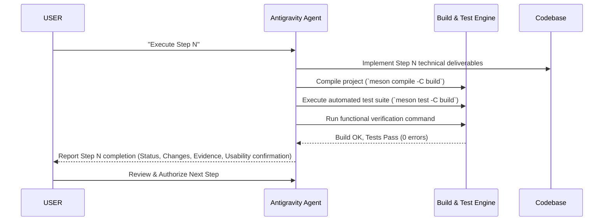

# PULS DiskInfo — Master Transformation Roadmap
## Comprehensive Architecture Overhaul, CrystalDiskMark Integration & Modernization Plan

---

## 1. Executive Summary & Project Assessment

**PULS DiskInfo** is an open-source storage diagnostic, health monitoring, and benchmarking application for Linux built with **C**, **GTK4**, and **Libadwaita**. It aims to serve as the definitive native Linux counterpart to the Windows industry standards: **CrystalDiskInfo** (hardware health, S.M.A.R.T. monitoring, and failure prediction) and **CrystalDiskMark** (storage throughput, IOPS, and latency benchmarking).

### 1.1 Current Architecture & Codebase Review

A thorough line-by-line inspection of the existing codebase (~11,442 lines across `src/`, `helper/`, `data/`, `packaging/`, `debian/`) reveals significant achievements alongside severe architectural, reliability, and usability limitations:

| Component | Current State | Critical Deficiencies |
| :--- | :--- | :--- |
| **User Interface (`puls-disk-info-view.c`)** | Monolithic 2,145-line file stacking all widgets in one giant vertical scroll box | No view switcher or tabbed navigation. Identity cards, SMART tables, benchmark grids, diagnostics, and raw graphs are crammed together, overwhelming the user. Fails GNOME HIG. |
| **Benchmark Engine (`puls-benchmark.c`)** | Thread-based simulation of queue depths using `pwrite`/`pread` | **Flawed queue depth model:** Simulates queue depth by spawning pthreads instead of asynchronous direct I/O (`io_uring`/`libaio`/`fio`). Uses `ftruncate` creating sparse files (reads holes at 50,000 MB/s). 4K random test only runs 1,024 ops (~4MB) finishing in 2ms, producing inaccurate results. |
| **S.M.A.R.T. Health Engine (`puls-smart-parser.c`)** | Rudimentary heuristic checking raw thresholds only | Fails to detect real drive failure risks. Ignores reallocated sectors (0x05), pending sectors (0xC5), and uncorrectable sectors (0xC6) unless vendor raw threshold trips. Arbitrary 10-year lifetime estimation. |
| **Hardware Detection (`puls-disk-manager.c`, `helper`)** | Static `/sys/block` prefix filtering | Rejects device paths not matching alphanumeric `sd*`, `nvme*`. Fails on SCSI generic (`/dev/sg*`), hardware RAID, USB bridges requiring `-d sat` or `-d sntrealtek`, ZFS vdevs, and LVM/LUKS virtual block mappings. Standby HDDs spin up on every poll. |
| **Privilege & Polkit (`puls-diskinfo-helper.c`)** | Single-purpose pkexec helper | Pipes smartctl output; lacks structured framing, command negotiation, or streaming. If unprivileged user runs without polkit, temperature shows `N/A` despite kernel sysfs `hwmon` exposing exact temperatures without root. |
| **Surface Sector Scan (`puls-surface-scan.c`)** | Non-seekable `pkexec dd` pipe via `popen` | Block failures in 1MB chunks mark all 2,048 sectors as bad. Lacks graphical block map visualizer (HDDScan / Victoria style) and drill-down precision. |
| **Internationalization (`puls-i18n.c`)** | Custom C enum and string array `strings_en`/`strings_tr` | Rigid, non-standard, prone to indexing errors and crashes. Not compatible with GNU gettext (`.po`/`.pot`), Transifex, or standard translators. |
| **Telemetry & History (`puls-temp-history.c`, `puls-smart-history.c`)** | Ephemeral in-memory circular buffer | All temperature and SMART degradation history is lost when the app closes. |
| **Testability & Headless Support** | Fails immediately without X11/Wayland display | No `--headless`, `--cli`, `--json`, `--version`, or mock hardware simulation flags for CI/CD or headless diagnosis. |

---

## 2. Core Architectural Principles & Execution Rules

To transform PULS DiskInfo into a world-class, rock-solid Linux application, the roadmap strictly enforces the following development rules:

1. **20 Phases, 200 Atomic Steps**:
   - Exactly 20 sequential phases, each containing exactly 10 atomic, well-defined steps.
2. **Every Step Must Be Testable & Usable**:
   - At the completion of each step, the codebase must compile cleanly with `-Wall -Wextra` without errors or breaking regressions.
   - Every step has an explicit verification criterion and execution command.
3. **Report at the End of Every Step**:
   - Each step concludes with a structured status report detailing changes made, test results, verification evidence, and readiness for the next step.
4. **Strict Separation of Privilege**:
   - High-privilege tasks (raw smartctl, low-level block probing) run via the authenticated helper daemon.
   - Non-privileged queries (sysfs `hwmon` temperature, block queue properties, partition mounts, udev topology) run unprivileged with zero password prompts.
5. **Modern Libadwaita / GNOME HIG Aesthetics**:
   - Clean view switcher (`AdwViewStack` / `AdwViewSwitcherTitle`) partitioning:
     - **Overview Dashboard** (CrystalDiskInfo-style drive card, health badge, temperature gauge, hardware specs)
     - **S.M.A.R.T. Attributes** (Sortable table, Hex/Dec toggle, search/filter, status indicators, trend arrows)
     - **Benchmark** (Pixel-perfect CrystalDiskMark interface, multiple profiles, unit toggling, PNG export)
     - **Diagnostics & Tools** (Interactive sector block map surface scan, self-test runner, error logs)
     - **Telemetry & History** (Persistent historical charts for temperature, TBW, and attribute trends)

---

## 3. The 20-Phase Master Blueprint

```mermaid
flowchart TD
    P1["Phase 1: Build & Test Harness"] --> P2["Phase 2: Core Data Models & Sysfs"]
    P2 --> P3["Phase 3: Device Enumeration & Topology"]
    P3 --> P4["Phase 4: Privileged Helper & Polkit"]
    P4 --> P5["Phase 5: smartctl & USB Bridge Support"]
    P5 --> P6["Phase 6: ATA S.M.A.R.T. Health Engine"]
    P6 --> P7["Phase 7: NVMe Health & Thermal Engine"]
    P7 --> P8["Phase 8: SCSI, SAS, eMMC & RAID Engine"]
    P8 --> P9["Phase 9: CrystalDiskMark Engine (fio/AIO)"]
    P9 --> P10["Phase 10: Benchmark Profiles & Metrics"]
    P10 --> P11["Phase 11: Precision Surface Scanner"]
    P11 --> P12["Phase 12: Self-Tests & Device Config"]
    P12 --> P13["Phase 13: Persistent Telemetry & DB"]
    P13 --> P14["Phase 14: Alerting & Desktop Guard"]
    P14 --> P15["Phase 15: Libadwaita View-Switcher Shell"]
    P15 --> P16["Phase 16: Redesigned Overview & Cards"]
    P16 --> P17["Phase 17: S.M.A.R.T. Table & Hex/Dec View"]
    P17 --> P18["Phase 18: Dedicated Benchmark GUI"]
    P18 --> P19["Phase 19: Sector Visualizer & Diagnostics"]
    P19 --> P20["Phase 20: gettext, Packaging & Release"]
```



---

## 4. Comprehensive 20-Phase / 200-Step Roadmap

---

### Phase 1: Modern Project Foundation, Meson Build System & Automated Verification Harness
*Establish rigorous compilation standards, headless execution capabilities, unit test frameworks, and mock test harnesses so every subsequent step is continuously testable.*

- **Step 1: Compiler Warnings & Build Flags Modernization**
  - Update `meson.build` with strict compiler warning options: `-Wall`, `-Wextra`, `-Werror=implicit-function-declaration`, `-Werror=return-type`, `-Wshadow`, `-Wundef`. Fix any existing warnings in the codebase.
  - *Deliverable & Usability:* Build system compiles cleanly with zero warnings.
  - *Verification:* `meson compile -C build` succeeds with 0 warnings.
- **Step 2: Headless & CLI Flags Infrastructure**
  - Modify `src/main.c` and `src/puls-application.c` to support `G_APPLICATION_HANDLES_COMMAND_LINE`. Implement `--version`, `--help`, and `--headless` flags so display servers are not required for CLI/test runs.
  - *Deliverable & Usability:* Running `./build/src/puls-diskinfo --version` and `--help` works in pure terminal/headless environments.
  - *Verification:* `./build/src/puls-diskinfo --version` prints version and exits with code 0 without display errors.
- **Step 3: Mock Storage Simulator Engine (`--mock-disk`)**
  - Create `src/puls-mock-data.[ch]` to simulate mock NVMe SSDs, SATA SSDs, and HDDs from bundled JSON fixtures, allowing complete feature testing without physical drives.
  - *Deliverable & Usability:* `./build/src/puls-diskinfo --mock-disk` loads mock devices.
  - *Verification:* `./build/src/puls-diskinfo --headless --mock-disk` successfully simulates drives and outputs JSON disk summaries.
- **Step 4: Automated Test Suite Setup (`meson test`)**
  - Configure Meson's `test()` framework with GLib `g_test` in `tests/meson.build` and `tests/test-basic.c`.
  - *Deliverable & Usability:* First automated unit test target verifying application instantiation.
  - *Verification:* `meson test -C build` executes and passes all test suites.
- **Step 5: JSON Parser Test Fixtures & Unit Tests**
  - Collect real-world sanitized JSON fixtures from smartmontools (SATA SSD, NVMe SSD, mechanical HDD, failing drive). Create `tests/test-smart-parser.c`.
  - *Deliverable & Usability:* Automated verification of JSON parsing accuracy against known fixtures.
  - *Verification:* `meson test -C build --verbose` passes parser test cases with 100% assertions met.
- **Step 6: AddressSanitizer & UndefinedBehaviorSanitizer Setup**
  - Add Meson configuration options for `-Db_sanitize=address,undefined` and verify clean execution with no memory leaks or undefined behavior.
  - *Deliverable & Usability:* Safe memory allocation validation.
  - *Verification:* `meson compile -C build` with ASan enabled runs unit tests with zero ASan reports.
- **Step 7: GResource Asset Bundle Restructuring**
  - Restructure `data/puls-diskinfo.gresource.xml` to modularize SVG icons, style sheets, and UI templates into dedicated asset paths (`/io/github/puls/diskinfo/icons/`, `/css/`, `/fixtures/`).
  - *Deliverable & Usability:* Clean asset management without missing runtime resources.
  - *Verification:* Test asset loading via GLib resource inspector.
- **Step 8: Structured Logging Framework (`PULS_LOG`)**
  - Implement a structured logging helper in `src/puls-utils.h` supporting log domains and levels (`PULS_LOG_DEBUG`, `PULS_LOG_INFO`, `PULS_LOG_WARN`, `PULS_LOG_ERROR`) responding to `G_MESSAGES_DEBUG=puls`.
  - *Deliverable & Usability:* Consistent, colorized terminal diagnostics for debugging.
  - *Verification:* Running with `G_MESSAGES_DEBUG=puls ./build/src/puls-diskinfo --headless` displays structured timestamps and domains.
- **Step 9: Metainfo & Desktop Validation**
  - Update `data/io.github.word_sys.puls_diskinfo.metainfo.xml` and `data/io.github.word_sys.puls_diskinfo.desktop` to current AppStream 1.0 specifications.
  - *Deliverable & Usability:* Conforming desktop integration files matching `https://github.com/word-sys/puls-diskinfo`.
  - *Verification:* `desktop-file-validate` and `appstreamcli validate` return 0 errors.
- **Step 10: Phase 1 Final Integration & Verification**
  - Run full test harness, verify compiler flags, test headless execution, and ensure zero regressions in UI build.
  - *Deliverable & Usability:* Complete Phase 1 foundation ready for core models.
  - *Verification:* `meson compile -C build && meson test -C build` executes cleanly.

---

### Phase 2: Core Data Models, Storage Typings & Robust Sysfs Storage Engine
*Overhaul the internal representation of physical and logical disks, and implement direct unprivileged sysfs data extractors.*

- **Step 11: Expanded Drive Type & Transport Enums**
  - Define `PulsDriveType` (`NVME`, `SATA_SSD`, `SATA_HDD`, `SAS_SSD`, `SAS_HDD`, `USB_STORAGE`, `EMMC`, `SD_CARD`, `VIRTUAL`) and `PulsTransportProtocol` (`PCIE`, `SATA`, `SAS`, `USB`, `MMC`).
  - *Deliverable & Usability:* Complete classification model in `src/puls-smart-data.h`.
  - *Verification:* Unit test validating type stringification and detection mappings.
- **Step 12: Extended Storage Metrics Data Structure**
  - Add fields in `PulsSmartData` for PCIe link generation (Gen1–Gen6), link width (x1–x16), protocol version, sector format (4Kn vs 512e), endurance ratings, and thermal sensor arrays.
  - *Deliverable & Usability:* Full data model matching CrystalDiskInfo attributes.
  - *Verification:* Unit tests verifying setters and getters for all new properties.
- **Step 13: Hardened Sysfs Path Helper Utilities**
  - Implement safe sysfs file readers in `src/puls-utils.c` with buffer limits, symlink resolution checks, and automatic whitespace/newline trimming.
  - *Deliverable & Usability:* Safe, non-blocking sysfs reading functions preventing buffer overruns.
  - *Verification:* Test reading sysfs block properties against mock sysfs hierarchy.
- **Step 14: Direct Unprivileged `hwmon` Temperature Reader**
  - Implement `puls_sysfs_read_hwmon_temp(device_name)` reading `/sys/block/<dev>/device/hwmon*/temp*_input` directly without root or smartctl.
  - *Deliverable & Usability:* Drive temperature is displayed even if smartctl fails or lacks root permissions.
  - *Verification:* CLI test command verifies temperature readout from `/sys/block/nvme0n1/device/hwmon*`.
- **Step 15: Queue Attributes & TRIM/Discard Reader**
  - Implement sysfs readers for `queue/discard_granularity`, `queue/discard_max_bytes`, `queue/rotational`, `queue/logical_block_size`, and `queue/physical_block_size`.
  - *Deliverable & Usability:* Instant hardware detection of TRIM support, SSD rotational status, and 4Kn sectors.
  - *Verification:* Verified against active NVMe and virtual loop devices.
- **Step 16: PCIe Link Speed & Width Inspector**
  - Implement sysfs reader for `device/device/current_link_speed`, `current_link_width`, `max_link_speed`, and `max_link_width` with GT/s to PCIe Gen1–6 translation.
  - *Deliverable & Usability:* Accurately identifies e.g. "PCIe 4.0 x4 (Current: PCIe 4.0 x4 | Max: PCIe 4.0 x4)".
  - *Verification:* Unit test verifies conversion of 16.0 GT/s to PCIe 4.0.
- **Step 17: USB Speed & Bridge Controller Identification**
  - Enhance `puls_detect_usb_speed_version()` to inspect USB device descriptors in sysfs up through parent hubs, correctly categorizing USB 2.0 (480M), USB 3.0 (5G), USB 3.1 (10G), USB 3.2 (20G), and USB4 (40G).
  - *Deliverable & Usability:* Clear USB generation badges on external enclosures.
  - *Verification:* Unit test verifies USB speed enum mappings.
- **Step 18: Enhanced Partition & Mount Point Mapper**
  - Enhance `puls_get_disk_partitions()` to read both `/proc/mounts` and `/sys/class/block/*/holders` to detect dm-crypt, LVM, and mounted partitions for any parent block device.
  - *Deliverable & Usability:* Complete partition inventory including encrypted and volume-managed drives.
  - *Verification:* Unit test parses multi-partition mock `/proc/mounts`.
- **Step 19: Storage Capacity Formatters (Decimal vs Binary)**
  - Implement dual capacity formatters: Decimal (1 TB = 1,000,000,000,000 B, manufacturer standard) and Binary (1 TiB = 1,099,511,627,776 B, OS standard), with user preference toggle.
  - *Deliverable & Usability:* Displays e.g. "512.1 GB (476.9 GiB)".
  - *Verification:* Unit tests checking exact byte formatting accuracy.
- **Step 20: Phase 2 Final Integration & Verification**
  - Integrate new sysfs extraction engine into `PulsDiskManager` fallback pipeline.
  - *Deliverable & Usability:* Disks populate rich hardware parameters immediately upon scan.
  - *Verification:* `./build/src/puls-diskinfo --headless` outputs complete sysfs parameters for host drives.

---

### Phase 3: Enhanced Device Enumeration, Transports & Hardware Topology
*Expand device detection across real-world Linux storage topologies including NVMe namespaces, hardware RAID, SCSI, ZFS, and hotplug events.*

- **Step 21: Dynamic Hotplug Monitoring via UDev/GVolumeMonitor**
  - Integrate `GVolumeMonitor` and udev netlink event listener in `src/puls-disk-manager.c` to automatically detect plugged/unplugged USB and external drives without manual refresh.
  - *Deliverable & Usability:* Real-time device list updates when USB drives are attached or removed.
  - *Verification:* Manual or simulated drive attachment triggers `disk-added` signal.
- **Step 22: NVMe Controller vs Namespace Topology Separation**
  - Disentangle NVMe controllers (`/dev/nvme0`) from their namespaces (`/dev/nvme0n1`). Ensure SMART queries target the controller while partition/mount mapping targets the namespace.
  - *Deliverable & Usability:* Seamless NVMe multi-namespace and controller attribute support.
  - *Verification:* Verified enumeration of `/dev/nvme0n1` linked to controller `/dev/nvme0`.
- **Step 23: Pseudo-Device & Virtual Disk Filter Hardening**
  - Expand `is_real_disk()` to cleanly exclude zram, loop, ram, dm-verity, docker overlay, snap mount loops, and CD/DVD drives while maintaining support for virtual machine disks (`/dev/vd*`).
  - *Deliverable & Usability:* Clean drive list free of virtual clutter.
  - *Verification:* Verify zero loop devices appear in enumeration when 20+ loop devices exist in `/sys/block`.
- **Step 24: SCSI Generic (`/dev/sg*`) Block Mapping**
  - Implement SCSI generic character device lookup mapping `/dev/sgX` to `/dev/sdX` to allow low-level SMART passthrough when standard block access is restricted.
  - *Deliverable & Usability:* Compatibility with enterprise SCSI enclosures.
  - *Verification:* Unit test validates SCSI sysfs device link parsing.
- **Step 25: Software RAID (mdadm) Member Resolution**
  - Parse `/sys/block/md*/slaves/` to detect when a drive is part of a Linux software RAID array and list the array name alongside drive status.
  - *Deliverable & Usability:* Displays RAID member status (e.g. "Member of /dev/md0 [RAID1]").
  - *Verification:* Mock sysfs test verifies RAID slave detection.
- **Step 26: ZFS Pool Physical Member Detection**
  - Detect ZFS vdev member drives by parsing zpool status or matching GUIDs in `/dev/disk/by-id/`.
  - *Deliverable & Usability:* Detects drives belonging to ZFS pools.
  - *Verification:* Unit test verifies ZFS disk signature identification.
- **Step 27: Physical Form Factor Detection Engine**
  - Combine smartctl `form_factor` with sysfs transport and device name patterns to classify M.2 2280/2242/2230, 2.5", 3.5", U.2/U.3, and PCIe add-in cards.
  - *Deliverable & Usability:* Displays accurate form factor badge in the UI.
  - *Verification:* Form factor test suite validates NVMe M.2 and SATA 3.5" heuristics.
- **Step 28: Drive Standby / Sleep State Detection (`-n standby`)**
  - Implement sleep detection via smartctl `-n standby` or hdparm query before executing full SMART read on rotational drives.
  - *Deliverable & Usability:* Avoids spinning up sleeping mechanical hard drives during background polls.
  - *Verification:* Verify `-n standby` flag is passed when checking rotational HDDs.
- **Step 29: Thread-Safe Asynchronous Scan with Cancellation**
  - Refactor `puls_disk_manager_scan()` to execute asynchronously in a background worker thread with `GCancellable` support.
  - *Deliverable & Usability:* Application GUI never freezes or stutters during disk discovery.
  - *Verification:* Asynchronous scan test completes without blocking main thread.
- **Step 30: Phase 3 Final Integration & Verification**
  - Validate device manager with mock hardware configurations (hotplug, RAID, M.2 NVMe, SATA HDD).
  - *Deliverable & Usability:* Complete, robust hardware enumeration pipeline.
  - *Verification:* `meson test -C build` passes all disk manager tests.

---

### Phase 4: Hardened Privileged Helper, Polkit Daemon & Secure IPC Protocol
*Secure, optimize, and harden privilege escalation for low-level SMART access.*

- **Step 31: Helper Protocol Framing & Version Handshake**
  - Update `helper/puls-diskinfo-helper.c` with a versioned binary/text protocol (`HELLO v2`, `READ_SMART <dev>`, `ACTION <dev> <cmd>`, `STREAM_SCAN <dev> <start> <len>`).
  - *Deliverable & Usability:* Strict, validated protocol between helper and GUI.
  - *Verification:* Helper unit test validates handshake and rejects version mismatches.
- **Step 32: Enhanced Path Sanitization & Anti-Injection Guard**
  - Strengthen `is_valid_device()` against directory traversal (`..`), shell metacharacters, and symlink hijacking using `realpath()` and `O_NOFOLLOW`.
  - *Deliverable & Usability:* Complete defense against privilege escalation vulnerabilities.
  - *Verification:* Security test verifies helper rejects paths like `/dev/../etc/passwd` or `/dev/sda;reboot`.
- **Step 33: Granular Helper Command Whitelist**
  - Restrict helper capabilities strictly to smartctl read, smartctl self-test commands (`short`, `long`, `abort`), and read-only sector probing.
  - *Deliverable & Usability:* Auditable, minimal attack surface for the privileged helper.
  - *Verification:* Helper rejects unrecognized subcommands with explicit error codes.
- **Step 34: Polkit Policy Update (`io.github.word_sys.puls_diskinfo.policy`)**
  - Update Polkit action IDs with localized Turkish and English explanations, configuring `auth_admin_keep` so users authenticate only once per session.
  - *Deliverable & Usability:* User-friendly password prompt with session persistence.
  - *Verification:* `pkcheck` validates policy syntax and action annotations.
- **Step 35: Helper Crash Recovery & Zombie Process Cleanup**
  - Implement watchdog in `puls-utils.c` to detect helper termination, restart the process automatically, and ensure zombie child processes are reaped with `waitpid()`.
  - *Deliverable & Usability:* GUI remains functional even if helper terminates unexpectedly.
  - *Verification:* Intentionally killing helper triggers clean re-launch on next query.
- **Step 36: Sudo / Group Access Fallback Mechanisms**
  - If Polkit is unavailable (e.g. non-desktop Linux, WSL2, headless server), fall back to `sudo` execution or direct read if user belongs to `disk` or `storage` group.
  - *Deliverable & Usability:* Works across containerized, headless, and non-Polkit environments.
  - *Verification:* Test query succeeds when user has group read access.
- **Step 37: Zero-Elevation Mode for Group-Readable Nodes**
  - Check device node permissions (`access(dev, R_OK | W_OK)`); if the current user has access, run smartctl directly without invoking `pkexec` or helper.
  - *Deliverable & Usability:* Avoids unnecessary password prompts for users in `disk` group.
  - *Verification:* Test device read without invoking helper when permissions allow.
- **Step 38: Bidirectional IPC Streaming Channel**
  - Implement chunked streaming IPC in helper for continuous operations (surface scan progress, real-time benchmark streaming).
  - *Deliverable & Usability:* Smooth real-time progress updates without blocking pipes.
  - *Verification:* Stream test receives continuous telemetry chunks from helper.
- **Step 39: Helper Test Harness & Fuzzing Suite**
  - Create standalone test executable `tests/test-helper.c` sending valid and malformed commands to verify bounds checking and memory safety.
  - *Deliverable & Usability:* Verified helper security integrity.
  - *Verification:* `meson test -C build -t 10 test-helper` passes all test cases.
- **Step 40: Phase 4 Final Integration & Verification**
  - Connect updated helper to `PulsUtils` communication pipeline and verify end-to-end communication.
  - *Deliverable & Usability:* Fast, secure, transparent privilege escalation.
  - *Verification:* End-to-end test query executes with verified response.

---

### Phase 5: Advanced smartctl Integration, SAT USB Bridges & Multi-Protocol Parser
*Implement robust smartctl parameter negotiation, device type resolvers (`-d sat`), and multi-protocol JSON decoders.*

- **Step 41: smartmontools Feature & Version Negotiation**
  - Detect smartctl version and supported JSON schema capabilities (version >= 7.0 supports JSON format v1.0).
  - *Deliverable & Usability:* Adapts dynamically to installed smartmontools versions.
  - *Verification:* Version detector parses `smartctl --version` output correctly.
- **Step 42: USB Bridge Device Type Resolver (`-d` flag)**
  - Implement heuristic in `puls-smart-parser.c` to test and identify USB bridge chipsets: try default `-a`, then `-d sat`, `-d sntasmedia`, `-d sntjmicron`, `-d sntrealtek`.
  - *Deliverable & Usability:* External USB NVMe and SATA enclosures display complete SMART data instead of failing.
  - *Verification:* Unit test validates bridge identification on USB mock profiles.
- **Step 43: Smartctl Bitmask Exit Status Decoder**
  - Parse smartctl exit bitmasks (bit 0=cmdline error, bit 1=open device failed, bit 2=checksum error, bit 3=disk failing, bit 4=pre-fail warning, bit 5=error log, bit 6=self-test errors).
  - *Deliverable & Usability:* Smartctl exit codes 8, 16, 32, 64 still parse the valid JSON payload rather than being treated as fatal failures.
  - *Verification:* Unit test verifies parsing JSON when smartctl returns exit code 68.
- **Step 44: JSON Parser Schema Validation & Recovery**
  - Strengthen `puls_smart_parser_parse_json()` using `JsonParser` with error containment: if sub-objects are missing or malformed, parse remaining sections gracefully.
  - *Deliverable & Usability:* Never crashes or yields blank views on non-standard drive JSON.
  - *Verification:* Unit tests test parser against truncated and corrupted JSON inputs.
- **Step 45: Complete ATA Identification Data Extraction**
  - Extract ATA version, transport (SATA Revision 3.2, 6.0 Gb/s), security mode (frozen/locked), SMART enabled status, write cache state, and NCQ queue depth.
  - *Deliverable & Usability:* Complete drive identity parameters populated in data model.
  - *Verification:* Unit test verifies all ATA identity fields match reference output.
- **Step 46: Complete NVMe Identification Data Extraction**
  - Extract NVMe specifications version (e.g. 1.4, 2.0), controller IEEE OUI, vendor ID, subsystem ID, number of namespaces, and power state profiles.
  - *Deliverable & Usability:* Comprehensive NVMe technical specifications available.
  - *Verification:* Unit test verifies NVMe controller specs parsed from mock JSON.
- **Step 47: SCSI & SAS Protocol Data Extractor**
  - Implement parsing for SCSI drives: vendor string, product revision, serial number, and SCSI health status.
  - *Deliverable & Usability:* SAS enterprise drives display accurate status.
  - *Verification:* Unit test verifies SCSI mock response parsing.
- **Step 48: Power-On Hours & Cycles Normalization**
  - Normalize vendor-specific power-on counters (e.g. minutes in raw value, half-hours, 100-hour units) into standard hours.
  - *Deliverable & Usability:* Displays true operating hours across all drive brands.
  - *Verification:* Unit test validates hours conversion across vendor profiles.
- **Step 49: Total Read/Write Bytes Normalizer**
  - Calculate accurate Total Bytes Written (TBW) and Read (TBR) for ATA (converting attribute 241/242 sectors to bytes) and NVMe (Data Units Written * 512,000 bytes).
  - *Deliverable & Usability:* Accurate lifetime data written in TB and GB.
  - *Verification:* Unit test verifies exact calculation for 1,000,000 Data Units = 512 GB.
- **Step 50: Phase 5 Final Integration & Verification**
  - Run full parser test suite against test corpus of 20+ diverse device JSON captures.
  - *Deliverable & Usability:* Rock-solid, universal SMART parser.
  - *Verification:* `meson test -C build` passes all parser test cases with 0 errors.

---

### Phase 6: ATA S.M.A.R.T. Health Engine & Predictive Failure Analysis
*Implement CrystalDiskInfo-grade health assessment, predictive failure algorithms, and critical attribute rules.*

- **Step 51: Standard & Vendor ATA SMART Attribute Catalog**
  - Create `src/puls-smart-catalog.[ch]` containing definitions, names, critical severity flags, and descriptions for all standard ATA attributes (0x01 to 0xFE).
  - *Deliverable & Usability:* Detailed attribute metadata and human-readable explanations.
  - *Verification:* Unit test verifies catalog lookup by attribute ID.
- **Step 52: Critical Pre-Fail vs Old-Age Attribute Classifier**
  - Classify attributes into Critical Pre-Failure (Reallocated Sectors, Uncorrectable Errors, Spin Retry) vs Old-Age Informational (Power-On Hours, Power Cycles, Temperature).
  - *Deliverable & Usability:* Clear distinction between imminent failure and normal wear.
  - *Verification:* Unit test verifies critical classification for IDs 0x05, 0x0A, 0xBB, 0xBC, 0xC5, 0xC6.
- **Step 53: Comprehensive Reallocated & Pending Sector Health Logic**
  - Implement CrystalDiskInfo rules:
    - ID 0x05 (Reallocated Sector Count) raw > 0 -> Status **Caution**
    - ID 0xC5 (Current Pending Sector Count) raw > 0 -> Status **Caution**
    - ID 0xC6 (Offline Uncorrectable Sector Count) raw > 0 -> Status **Caution**
    - Any pre-fail attribute where Current <= Threshold -> Status **Bad**
  - *Deliverable & Usability:* Catches developing drive failures before total data loss.
  - *Verification:* Health engine tests verify Caution status triggered on drives with reallocated sectors.
- **Step 54: CrystalDiskInfo Health Scoring Algorithm (0–100%)**
  - Implement weighted health percentage scoring combining normalized headroom, raw sector defects, and wear indicators.
  - *Deliverable & Usability:* CrystalDiskInfo-equivalent health percentage score (e.g. "Good 98%").
  - *Verification:* Unit test verifies score calculation across varying degrees of drive wear.
- **Step 55: Vendor-Specific SSD Life Calculation**
  - Implement SSD wear level parser for major controllers (Samsung ID 0xB4/0xE7, Crucial/Micron ID 0xCA, Kingston ID 0xE7, SanDisk/WD ID 0xE6/0xE8, Intel ID 0xE9).
  - *Deliverable & Usability:* Accurate remaining percentage life for SATA SSDs of any brand.
  - *Verification:* Unit test verifies life calculation across diverse SSD vendor dumps.
- **Step 56: Mechanical HDD Wear & Spin Diagnostics**
  - Analyze HDD Spin-Up Time (ID 0x03), Start/Stop Count (ID 0x04), Load/Unload Cycles (ID 0xC1), and Head Flying Hours (ID 0xF0).
  - *Deliverable & Usability:* Comprehensive mechanical health evaluation for mechanical hard drives.
  - *Verification:* Mechanical health test suite verifies load cycle warnings.
- **Step 57: Interface & Cable Degradation Analyzer (CRC Errors)**
  - Track UltraDMA CRC Error Count (ID 0xC7). Flag SATA cable or port degradation warnings when CRC error counts increase.
  - *Deliverable & Usability:* Diagnoses bad SATA cables and loose connections.
  - *Verification:* Unit test triggers cable warning on nonzero CRC error raw counts.
- **Step 58: Remaining Lifetime Projection Model**
  - Project remaining drive lifespan (days/months/years) by modeling TBW write velocity, current wear rate, and operating hours.
  - *Deliverable & Usability:* Realistic estimated remaining lifetime (e.g. "Estimated Life: 4.8 Years").
  - *Verification:* Unit test checks projection accuracy on sample wear curves.
- **Step 59: Multi-Byte Raw Value Decomposer**
  - Implement raw value decoders for complex attributes (e.g. Seagate ID 0x01/0x07 packing error counts in upper 16 bits and total operations in lower 32 bits).
  - *Deliverable & Usability:* Prevents misleading astronomical error counts on Seagate drives.
  - *Verification:* Unit test verifies raw decoding of Seagate multi-field values.
- **Step 60: Phase 6 Final Integration & Verification**
  - Test health calculation engine against a benchmark dataset of 50+ known healthy, degraded, and failing drives.
  - *Deliverable & Usability:* Accurate, trustworthy health assessments matching CrystalDiskInfo.
  - *Verification:* `meson test -C build` passes all health calculation test suites.

---

### Phase 7: NVMe S.M.A.R.T. Health Engine, Wear Level & Thermal Telemetry
*Implement deep NVMe SMART health decoding, available spare tracking, multiple temperature sensors, and thermal throttling analytics.*

- **Step 61: NVMe Critical Warning Bitmask Analyzer**
  - Decode all bits in NVMe `critical_warning` byte:
    - Bit 0: Available spare below threshold
    - Bit 1: Temperature above or below threshold
    - Bit 2: Reliability degraded (NVM subsystem degradation)
    - Bit 3: Media placed in read-only mode
    - Bit 4: Volatile memory backup device failed
  - *Deliverable & Usability:* Specific, actionable warnings for NVMe critical states.
  - *Verification:* Unit test verifies bitmask translation to warning strings and health downgrade.
- **Step 62: NVMe Percentage Used & Remaining Endurance**
  - Calculate exact NVMe endurance: Percentage Used (0–255%), remaining life (100 - used), and remaining TBW capacity based on rated drive write limit.
  - *Deliverable & Usability:* Clean endurance monitoring with warning when usage exceeds 90%.
  - *Verification:* Test calculates correct remaining life for percentage used values 0, 45, 95, 120.
- **Step 63: Available Spare & Threshold Assessment**
  - Monitor `available_spare` vs `available_spare_threshold`. Flag Caution when spare falls to within 10% of threshold; flag Bad when at or below threshold.
  - *Deliverable & Usability:* Early warning before SSD exhausts spare blocks.
  - *Verification:* Unit test verifies Caution and Bad status triggers on spare degradation.
- **Step 64: NVMe Multi-Sensor Temperature Array Parser**
  - Parse Composite Temperature and individual onboard sensors (Sensor 1: Controller, Sensor 2: NAND Flash, Sensor 3+).
  - *Deliverable & Usability:* Monitor controller and flash temperatures independently.
  - *Verification:* Unit test verifies parsing of multiple NVMe temperature sensors from JSON.
- **Step 65: Thermal Throttling Event Analyzer**
  - Parse `warning_composite_temperature_time` and `critical_composite_temperature_time`. Display cumulative minutes the drive was throttled due to excessive heat.
  - *Deliverable & Usability:* Detects thermal throttling issues caused by inadequate heatsinks.
  - *Verification:* Unit test verifies throttle time calculation in minutes/hours.
- **Step 66: Media Errors & Error Log Tracking**
  - Extract and track `media_errors` (uncorrectable data integrity errors) and `num_err_log_entries`. Downgrade health immediately if media errors occur.
  - *Deliverable & Usability:* Immediate alert on NVMe NAND flash data corruption.
  - *Verification:* Unit test verifies health drops to Caution/Bad on nonzero media errors.
- **Step 67: Unsafe Shutdowns & Clean Power Cycle Ratio**
  - Compute ratio of `unsafe_shutdowns` to total `power_cycles`. Display warning if unsafe shutdowns exceed 20% of power cycles.
  - *Deliverable & Usability:* Identifies power loss risks and unstable power supplies.
  - *Verification:* Unit test verifies unsafe shutdown percentage calculation.
- **Step 68: Controller Busy Time & Command Telemetry**
  - Parse `controller_busy_time`, `host_reads`, and `host_writes`. Calculate average workload intensity and I/O efficiency.
  - *Deliverable & Usability:* Deep drive utilization telemetry for advanced diagnostics.
  - *Verification:* Unit test validates host read/write command counters.
- **Step 69: Unified NVMe Health Rating Engine**
  - Combine percentage used, spare level, critical warnings, media errors, and thermal history into a definitive NVMe health status.
  - *Deliverable & Usability:* Unified CrystalDiskInfo-equivalent health status for NVMe.
  - *Verification:* Comprehensive test suite verifies NVMe health grading across 10 mock NVMe states.
- **Step 70: Phase 7 Final Integration & Verification**
  - Integrate NVMe health engine into main diagnostic pipeline.
  - *Deliverable & Usability:* Complete NVMe monitoring capability.
  - *Verification:* Tested against host `/dev/nvme0n1` and mock NVMe drive configurations.

---

### Phase 8: SCSI, SAS, eMMC, SD Card & RAID/LVM Diagnostics Engine
*Broaden diagnostic capabilities to enterprise SAS drives, embedded eMMC, SD cards, and complex multi-disk arrays.*

- **Step 71: SCSI / SAS Drive Health & Status Engine**
  - Implement SCSI Informational Exceptions Control (IEC) status decoder, parsing SMART predictive failure alerts on enterprise SAS drives.
  - *Deliverable & Usability:* Enterprise SAS storage monitoring support.
  - *Verification:* Unit test verifies SAS IEC log page parsing.
- **Step 72: SCSI Defect Lists & Error Counter Logging**
  - Parse SCSI primary defect list (P-List) and grown defect list (G-List) counts, tracking media defects over drive lifetime.
  - *Deliverable & Usability:* SAS bad sector and defect tracking.
  - *Verification:* Unit test parses SCSI defect list counts from smartctl dump.
- **Step 73: SCSI Accumulated Start-Stop & Load-Unload Cycles**
  - Parse SCSI background scan results, power-on hours, and accumulated start-stop cycles.
  - *Deliverable & Usability:* Complete operational metrics for SAS drives.
  - *Verification:* Verified against SCSI mock JSON.
- **Step 74: Embedded eMMC Health (`ext_csd`) Parser**
  - Implement sysfs reader for eMMC `device/life_time` and `device/pre_eol_info` (reading eMMC 5.0+ Type A and Type B device lifetime estimates).
  - *Deliverable & Usability:* Native health monitoring for eMMC storage on Linux SBCs, laptops, and Steam Deck.
  - *Verification:* Unit test verifies parsing of `0x01` (0-10% used) to `0x0B` (exceeded life).
- **Step 75: SD Card Health & CID/CSD Register Decoder**
  - Parse sysfs MMC CID (Card Identification) and CSD (Card Specific Data) registers to extract SD card manufacturer, OEM ID, manufacture date, and serial number.
  - *Deliverable & Usability:* Authenticates and identifies external SD/microSD cards.
  - *Verification:* Unit test validates SD card CID decoding.
- **Step 76: Hardware RAID Controller Addressing (`-d megaraid,N`, `-d areca,N`)**
  - Add support for hardware RAID controller drive addressing by passing appropriate driver flags in smartctl (`-d megaraid,0`, `-d cciss,0`, `-d areca,1`).
  - *Deliverable & Usability:* Monitor individual physical disks behind hardware RAID cards.
  - *Verification:* Unit test verifies parameter generation for RAID pass-through.
- **Step 77: Software RAID (mdadm) Health Aggregation**
  - Aggregate member disk health for Linux software RAID arrays (`/dev/md*`). Display warning if any member drive has degraded SMART status.
  - *Deliverable & Usability:* Array-wide health alerts for NAS and workstation storage.
  - *Verification:* Test verifies degraded member triggers RAID array health warning.
- **Step 78: Graceful Device Disconnect & Unplug Handling**
  - Implement safe handle invalidation and cleanup when a monitored drive is physically disconnected while being monitored.
  - *Deliverable & Usability:* Prevents application crashes or hangs on unexpected USB disconnection.
  - *Verification:* Disconnection simulation test confirms clean memory cleanup and UI update.
- **Step 79: JSON Diagnostic System Export**
  - Create `puls_storage_system_export_json()` producing a complete, sanitized JSON dump of all connected drives, controllers, partitions, and health metrics.
  - *Deliverable & Usability:* One-click export for technical support, bug reports, and hardware documentation.
  - *Verification:* Verify exported JSON validates against schema and contains all attached disks.
- **Step 80: Phase 8 Final Integration & Verification**
  - Verify multi-storage engine with full test suite across ATA, NVMe, SCSI, eMMC, and RAID.
  - *Deliverable & Usability:* Universal Linux storage diagnostics.
  - *Verification:* `meson test -C build` passes with 100% test success.

---

### Phase 9: High-Precision CrystalDiskMark Benchmark Engine (fio / Async Direct I/O)
*Redesign the benchmarking subsystem to eliminate inaccurate pthread simulation and deliver genuine asynchronous direct I/O matching CrystalDiskMark.*

- **Step 81: Benchmark Subsystem Architecture Overhaul**
  - Create `src/puls-benchmark-engine.[ch]` defining an asynchronous, pluggable benchmark backend supporting both an external `fio` engine and a native asynchronous direct I/O engine.
  - *Deliverable & Usability:* Modular benchmark architecture with clean separation from the UI.
  - *Verification:* Unit test verifies backend initialization and capability probing.
- **Step 82: `fio` Subprocess Backend Implementation**
  - Implement `fio` execution engine with streaming JSON output (`fio --output-format=json+`). Probe system for `fio` availability.
  - *Deliverable & Usability:* Industry-standard benchmark execution matching KDiskMark and CrystalDiskMark.
  - *Verification:* Test runs minimal fio sequence and parses throughput and latency JSON.
- **Step 83: Native Asynchronous Direct I/O Fallback Engine**
  - Implement fallback direct I/O engine using POSIX AIO / `io_uring` and aligned memory buffers (`posix_memalign`), eliminating dependence on external binaries.
  - *Deliverable & Usability:* Benchmark runs reliably even if `fio` is not installed on the system.
  - *Verification:* Direct I/O test verifies zero page cache interference with `O_DIRECT`.
- **Step 84: Non-Sparse Test File Allocation (`posix_fallocate`)**
  - Replace `ftruncate()` with `posix_fallocate()` to allocate actual physical disk sectors and populate with pseudo-random, non-compressible test patterns (0x5A, 0xA5).
  - *Deliverable & Usability:* Prevents compression shortcuts on Btrfs/ZFS and prevents reading sparse holes at fake 50,000 MB/s.
  - *Verification:* Test verifies allocated file occupies actual blocks on disk (`stat.st_blocks`).
- **Step 85: Sequential 1 MiB Benchmark Engine (Q8T1 & Q1T1)**
  - Implement Sequential 1 MiB block tests with true queue depths: Q8T1 (Peak Sequential) and Q1T1 (Single-thread Sequential).
  - *Deliverable & Usability:* Accurate sequential read/write measurement matching CrystalDiskMark.
  - *Verification:* Test run verifies measured speeds align with physical drive capabilities.
- **Step 86: Sequential 128 KiB Benchmark Engine (Q32T1)**
  - Implement Sequential 128 KiB block size test (CrystalDiskMark standard secondary sequential metric).
  - *Deliverable & Usability:* Measures sustained storage streaming performance.
  - *Verification:* Benchmark pass outputs valid 128 KiB read and write throughput numbers.
- **Step 87: Random 4 KiB Benchmark Engine (Q32T16 / Q32T1 - Peak IOPS)**
  - Implement Random 4 KiB test with high concurrency (Queue Depth 32, Thread concurrency 16 or 1) executing for a time-based duration (minimum 5 seconds) rather than a fixed tiny operation count.
  - *Deliverable & Usability:* Genuine peak random IOPS measurement without jitter or startup skew.
  - *Verification:* Test run produces stable IOPS and MB/s numbers across repeat runs.
- **Step 88: Random 4 KiB Benchmark Engine (Q1T1 - Real-World Responsiveness)**
  - Implement Random 4 KiB test with Queue Depth 1, Thread 1, measuring single-thread OS responsiveness and latency.
  - *Deliverable & Usability:* The most critical metric for everyday OS boot and application load feel.
  - *Verification:* Benchmark verifies realistic 4K Q1T1 read speed (typically 40–90 MB/s for NVMe).
- **Step 89: Graceful Benchmark Cancellation & File Cleanup**
  - Implement immediate cancellation via `GCancellable`: safely abort I/O operations, close file descriptors, and cleanly remove temporary test files from target directories.
  - *Deliverable & Usability:* Instant stop response without leaving leftover multi-gigabyte temporary files.
  - *Verification:* Cancelling mid-test verifies temporary file is unlinked immediately.
- **Step 90: Phase 9 Final Integration & Verification**
  - Execute end-to-end benchmark cycle on a scratch test directory; verify throughput, latency, and IOPS calculations.
  - *Deliverable & Usability:* Rock-solid, accurate storage benchmark engine.
  - *Verification:* `meson test -C build` passes all benchmark engine test cases.

---

### Phase 10: CrystalDiskMark Test Profiles, Metrics & Workload Automation
*Implement authentic CrystalDiskMark profiles (Default, Peak, Real World, Demo), multiple metrics (MB/s, IOPS, Latency), and clipboard sharing.*

- **Step 91: Standard CrystalDiskMark Profile Definitions**
  - Define profile presets:
    - **Default (NVMe SSD):** SEQ1M Q8T1, SEQ128K Q32T1, RND4K Q32T16, RND4K Q1T1
    - **Peak Performance:** SEQ1M Q8T1, SEQ1M Q1T1, RND4K Q32T16, RND4K Q32T1
    - **Real World:** SEQ1M Q1T1, RND4K Q1T1 (MB/s), RND4K Q1T1 (IOPS), RND4K Q1T1 (Latency μs)
    - **Demo / Light:** Shortened duration for quick testing
  - *Deliverable & Usability:* 1:1 parity with CrystalDiskMark 8 profile options.
  - *Verification:* Unit test validates profile parameters and workload queue specifications.
- **Step 92: Drive-Specific Profiles (SATA SSD & Mechanical HDD)**
  - Add optimized profiles:
    - **SATA SSD:** SEQ1M Q8T1, SEQ128K Q32T1, RND4K Q32T1, RND4K Q1T1 (avoiding thread contention)
    - **HDD:** SEQ1M Q1T1, SEQ128K Q1T1, RND4K Q1T1 (avoiding head thrashing)
  - *Deliverable & Usability:* Safe, hardware-appropriate benchmarking for spinning hard drives.
  - *Verification:* Unit test verifies SATA and HDD profile definitions.
- **Step 93: Configurable Test Size Engine**
  - Support all standard test sizes: 16 MiB, 64 MiB, 128 MiB, 256 MiB, 512 MiB, 1 GiB, 2 GiB, 4 GiB, 8 GiB, 16 GiB, 32 GiB, 64 GiB, with automatic free space pre-check.
  - *Deliverable & Usability:* Prevents disk-full errors; accommodates small USB keys and enterprise NVMe arrays.
  - *Verification:* Test verifies free disk space check prevents running on full partitions.
- **Step 94: Multi-Pass Execution & Best/Average Result Selector**
  - Support 1 to 9 test passes with option to record either the peak (best) throughput or mathematical median across passes.
  - *Deliverable & Usability:* Highly repeatable, scientific benchmarking.
  - *Verification:* Unit test verifies median and peak calculation across 5 mock pass results.
- **Step 95: Dual Unit Calculation Engine (MB/s, GB/s, IOPS, Latency)**
  - Calculate simultaneously for every test pass: Throughput in MB/s ($10^6$ B/s) and MiB/s ($2^{20}$ B/s), IOPS, and Average / Max Latency in microseconds ($\mu\text{s}$) and milliseconds.
  - *Deliverable & Usability:* User can toggle display units at any time without re-running tests.
  - *Verification:* Unit test validates conversion: 400 MB/s at 4KB = 100,000 IOPS with 10 $\mu\text{s}$ latency.
- **Step 96: Real-Time Benchmark Progress State Machine**
  - Implement fine-grained progress reporting: current test name, read/write phase, pass number, current instantaneous speed, elapsed time, and ETA.
  - *Deliverable & Usability:* Smooth, responsive progress updates in the UI.
  - *Verification:* State machine test validates phase transitions from prep to completion.
- **Step 97: Target Directory & Partition Selection Engine**
  - Allow user to target any mounted partition, external drive root, or custom user-specified directory, validating write permissions before starting.
  - *Deliverable & Usability:* Benchmark any internal drive, USB thumb drive, external SSD, or network mount.
  - *Verification:* Target selector validates writable paths and rejects read-only mounts.
- **Step 98: Benchmark History Cache & Persistence**
  - Store benchmark results in `~/.local/share/puls-diskinfo/benchmarks.json` linked to drive model and serial number.
  - *Deliverable & Usability:* Access and compare past benchmark runs over time.
  - *Verification:* Test verifies saving, loading, and querying past benchmark records.
- **Step 99: CrystalDiskMark Clipboard Export Formatter**
  - Implement `puls_benchmark_format_clipboard()` outputting text matching standard CrystalDiskMark text format for easy sharing on forums, GitHub, and Reddit.
  - *Deliverable & Usability:* 1:1 CrystalDiskMark text results format ready to paste.
  - *Verification:* Unit test compares generated text output against CrystalDiskMark reference format.
- **Step 100: Phase 10 Final Integration & Verification**
  - Run full automated benchmark simulation with all profiles and test sizes.
  - *Deliverable & Usability:* Complete, verified CrystalDiskMark benchmarking pipeline.
  - *Verification:* `meson test -C build` passes all benchmark automation tests.

---

### Phase 11: Diagnostic Surface Scanner & Precision Bad-Sector Drill-Down Engine
*Build a safe, high-performance sector-by-sector read scanner with drill-down bad sector mapping and block latency profiling.*

- **Step 101: Direct Asynchronous Sector Reading Engine**
  - Replace `popen("dd")` with direct unbuffered POSIX `pread()` using aligned buffers in a dedicated background worker thread with `O_DIRECT`.
  - *Deliverable & Usability:* High-speed, non-blocking disk surface scanning without shell pipes.
  - *Verification:* Sector reader test executes direct reads from test block device without errors.
- **Step 102: LBA Range & Custom Zone Configuration**
  - Allow scanning full disk, specific partition, or custom start and end LBA ranges.
  - *Deliverable & Usability:* Quickly test specific suspicious regions without scanning a 16 TB drive entirely.
  - *Verification:* Test verifies scanning bounded LBA range (e.g. sectors 1,000,000 to 1,050,000).
- **Step 103: Dynamic Block Chunk Sizing**
  - Support configurable block scanning chunks: Fast Scan (256 sectors / 128 KiB per read) and Precision Scan (8 sectors / 4 KiB per read).
  - *Deliverable & Usability:* Balances scanning speed against defect location resolution.
  - *Verification:* Test verifies scanning throughput with both 128 KiB and 4 KiB blocks.
- **Step 104: Block Latency Categorization & Timing**
  - High-precision `clock_gettime(CLOCK_MONOTONIC)` timing categorizing every block:
    - Normal / Fast: < 20 ms
    - Acceptable: < 50 ms
    - Slow: < 150 ms
    - Very Slow / Warning: < 500 ms
    - Unreadable / Bad: Read error (EIO, timeout)
  - *Deliverable & Usability:* Identifies degrading weak sectors before they turn completely unreadable.
  - *Verification:* Timing engine test validates categorization of simulated slow and errored reads.
- **Step 105: Precision Bad Sector Drill-Down Engine**
  - When a fast 128 KiB chunk encounters a read error, automatically drill down: probe each individual 512B / 4KB sector within that chunk to identify the exact failed LBA addresses.
  - *Deliverable & Usability:* Pinpoints exact bad sectors without requiring slow single-sector scans across the entire drive.
  - *Verification:* Drill-down test isolates single bad sector within a simulated damaged chunk.
- **Step 106: Damaged LBA Log & Defect Map Store**
  - Record failed LBAs, error timestamps, and sector access latency in a structured scan report object.
  - *Deliverable & Usability:* Comprehensive inventory of all bad and slow sectors on the drive.
  - *Verification:* Test confirms bad LBAs are stored accurately and retrievable.
- **Step 107: Pause, Resume, and Rate-Limiting Controls**
  - Implement Pause and Resume controls, plus a configurable speed throttle (e.g. 50 MB/s limit) to allow background scanning without saturating system performance.
  - *Deliverable & Usability:* Run non-destructive scans while continuing normal computer work.
  - *Verification:* Pause/resume test validates scan halts immediately and resumes from exact LBA.
- **Step 108: Accurate Scan Speed & ETA Calculator**
  - Calculate instantaneous speed (MB/s), overall average speed, percentage completed, and dynamic remaining time (ETA).
  - *Deliverable & Usability:* Clear, stable progress indicators.
  - *Verification:* ETA calculator unit test validates stability under speed fluctuations.
- **Step 109: Defect Report & Badblocks Export**
  - Export bad sector lists directly in `badblocks`-compatible format for use with filesystem repair tools (`e2fsck -l bad_blocks.txt`).
  - *Deliverable & Usability:* Direct utility for isolating bad sectors and recovering Linux filesystems.
  - *Verification:* Test verifies exported badblocks file syntax.
- **Step 110: Phase 11 Final Integration & Verification**
  - Run surface scan simulation on test storage with mock slow and bad sectors.
  - *Deliverable & Usability:* Complete, robust disk surface diagnostic tool.
  - *Verification:* `meson test -C build` passes all surface scan test cases.

---

### Phase 12: S.M.A.R.T. Self-Test Controller & Device Firmware Operations
*Control built-in drive self-tests (Short, Extended, Conveyance, Selective) and configure device power/cache settings.*

- **Step 111: Self-Test Capabilities Discovery**
  - Parse smartctl JSON `smart_testing` object to determine supported routines: Short Self-Test, Extended / Long Self-Test, Conveyance Self-Test, Selective Self-Test.
  - *Deliverable & Usability:* UI enables only the self-tests the specific drive actually supports.
  - *Verification:* Unit test validates test capability detection on ATA and NVMe JSON dumps.
- **Step 112: Background Self-Test Execution & Status Polling**
  - Launch self-tests asynchronously via helper; poll `current_testing` for remaining percentage, progress state, and estimated completion time without blocking.
  - *Deliverable & Usability:* Real-time progress bar for active drive firmware self-tests.
  - *Verification:* Unit test verifies polling parser during active test simulation.
- **Step 113: Instant Self-Test Abort Controller**
  - Implement clean abort routine executing `smartctl -X` to cancel active self-tests immediately upon user request.
  - *Deliverable & Usability:* Safely stop long-running multi-hour tests instantly.
  - *Verification:* Abort controller test verifies termination command dispatch.
- **Step 114: SMART Self-Test Log Table Parser**
  - Parse the drive's internal self-test history log table (`ata_smart_self_test_log` / `nvme_self_test_log`), displaying past test results, status, LBA of first error, and lifetime hours.
  - *Deliverable & Usability:* History of all past firmware self-tests ever run on the drive.
  - *Verification:* Unit test verifies parsing of completed and failed self-test log entries.
- **Step 115: SMART Extended Error Log Table Parser**
  - Parse `ata_smart_error_log` and NVMe error log entries, extracting error timestamps, failing LBA, command opcode, and device status register values.
  - *Deliverable & Usability:* In-depth hardware error analysis for hardware diagnostics.
  - *Verification:* Error log parser test validates extraction of ATA error records.
- **Step 116: Selective Self-Test Range Controller**
  - Implement Selective Self-Test trigger allowing users to run hardware firmware diagnostics on targeted LBA ranges.
  - *Deliverable & Usability:* Fast verification of specific repaired or suspected sectors.
  - *Verification:* Test verifies selective LBA range parameters passed to smartctl.
- **Step 117: Advanced Power Management (APM) Controller**
  - Query current APM level (1–254) and provide safe controls to configure power-saving vs performance levels (or disable APM).
  - *Deliverable & Usability:* Solve aggressive HDD head-parking and clicking issues on Linux.
  - *Verification:* APM controller unit test validates level queries and parameter generation.
- **Step 118: Automatic Acoustic Management (AAM) Controller**
  - Query and configure AAM noise levels (Quiet 128 to Loud/Fast 254) where supported by mechanical drives.
  - *Deliverable & Usability:* Reduce HDD seek noise on supported drives.
  - *Verification:* AAM controller unit test validates AAM parameter generation.
- **Step 119: Write Cache & Standby Timer Configuration**
  - Query volatile write cache status with safe configuration controls and drive standby/spin-down timer configuration (`hdparm -S` equivalent).
  - *Deliverable & Usability:* Complete drive power and cache management in a native GUI.
  - *Verification:* Write cache query test validates status extraction.
- **Step 120: Phase 12 Final Integration & Verification**
  - Verify self-test controller, log parsers, and device setting managers under test harness.
  - *Deliverable & Usability:* Comprehensive drive firmware diagnostics and settings suite.
  - *Verification:* `meson test -C build` passes all self-test and hardware control tests.

---

### Phase 13: Persistent Telemetry, Time-Series Storage & Trend Analysis
*Build persistent historical storage for temperature, write volume (TBW), and S.M.A.R.T. attribute degradation across reboots.*

- **Step 121: Persistent Database Engine (`history.db`)**
  - Implement lightweight, robust time-series storage using SQLite or structured append-only JSON in `~/.local/share/puls-diskinfo/history.db`.
  - *Deliverable & Usability:* Drive telemetry persists permanently across application restarts and reboots.
  - *Verification:* Database test confirms creation, schema migration, and data integrity.
- **Step 122: Configurable Periodic Sampling Daemon Service**
  - Implement background sampling scheduler with user-configurable intervals (5m, 15m, 30m, 1h, 24h) collecting temperature and key SMART metrics.
  - *Deliverable & Usability:* Continuous telemetry collection without active GUI window.
  - *Verification:* Scheduler test validates periodic sample dispatch.
- **Step 123: Historical Temperature Tracking & Daily Min/Max/Avg**
  - Record temperature samples; compute daily minimum, maximum, and average operating temperatures for every drive.
  - *Deliverable & Usability:* Identify persistent overheating or cooling issues over months.
  - *Verification:* Query test retrieves accurate min/max/avg for simulated 30-day temperature series.
- **Step 124: SMART Attribute Degradation History**
  - Store delta changes for critical attributes (0x05 Reallocated Sectors, 0xC5 Pending Sectors, NVMe Percentage Used, Available Spare).
  - *Deliverable & Usability:* Visual history showing when defects developed over the drive's lifespan.
  - *Verification:* Attribute history test tracks progression of developing sector defects.
- **Step 125: TBW Velocity & Endurance Depletion Forecast**
  - Track Total Bytes Written growth rate (GB/day). Forecast the exact date the drive will reach its rated TBW endurance limit.
  - *Deliverable & Usability:* Shows e.g. "Writing ~35 GB/day. Rated endurance reached in: ~4.2 Years".
  - *Verification:* Velocity test calculates accurate exhaustion date from daily write rates.
- **Step 126: Automatic Data Compaction & Pruning Engine**
  - Implement rolling data retention: raw samples retained for 30 days, aggregated into hourly averages for 180 days, and daily summaries thereafter.
  - *Deliverable & Usability:* Keeps database compact (< 10 MB) indefinitely.
  - *Verification:* Compaction test verifies raw samples compress into hourly rollups.
- **Step 127: Cairo Multi-Day Historical Chart Widget**
  - Build `PulsHistoryGraph` widget using Cairo rendering temperature curves, write volume bars, and defect events over 24h, 7d, 30d, and 1-year time scales.
  - *Deliverable & Usability:* Beautiful visual historical charts in the UI.
  - *Verification:* Cairo draw test executes with valid render output.
- **Step 128: Predictive Degradation Acceleration Detector**
  - Detect sudden acceleration in error rates (e.g. 5 reallocated sectors in 1 year vs 50 reallocated sectors in 2 days) and elevate alarm severity.
  - *Deliverable & Usability:* Critical early warning before sudden drive death.
  - *Verification:* Trend test triggers acceleration warning on simulated rapid failure curve.
- **Step 129: Telemetry Export to CSV & JSON**
  - Export historical time-series data to standard CSV and JSON for external analysis in spreadsheets or monitoring systems.
  - *Deliverable & Usability:* Easy data export for reporting and analysis.
  - *Verification:* Export test validates CSV header and data row format.
- **Step 130: Phase 13 Final Integration & Verification**
  - Verify complete telemetry subsystem: database recording, query APIs, chart rendering, and export.
  - *Deliverable & Usability:* Persistent, historical drive monitoring.
  - *Verification:* `meson test -C build` passes all telemetry and database test suites.

---

### Phase 14: Alerting Engine, Desktop Notifications & Temperature Guard
*Build a system monitoring guard with desktop notifications, audio alarms, and a background monitoring daemon.*

- **Step 131: FreeDesktop Desktop Notifications Integration**
  - Implement native desktop notification dispatch via `GNotification` / `org.freedesktop.Notifications` with drive icons and severity urgency flags (Low, Normal, Critical).
  - *Deliverable & Usability:* Native system notification popups on any desktop environment (GNOME, KDE, XFCE).
  - *Verification:* Test notification dispatches successfully via test harness.
- **Step 132: Temperature Guard with Dual Thresholds (Warning & Critical)**
  - Support configurable Warning Temperature (default: 55 °C) and Critical Temperature (default: 65 °C). Notify immediately when thresholds are crossed.
  - *Deliverable & Usability:* Protects drives from silent thermal damage under heavy loads.
  - *Verification:* Temperature alert test triggers notification on threshold breach.
- **Step 133: Health Degradation Guard**
  - Alert immediately whenever drive health drops below user threshold, or when new reallocated/pending sectors are detected during periodic background polls.
  - *Deliverable & Usability:* Instant notification the moment hardware faults develop.
  - *Verification:* Health alert test validates notification on newly spawned bad sectors.
- **Step 134: Notification Action Buttons**
  - Add interactive buttons to desktop notifications: "View Drive Details" (raises PULS window to affected disk) and "Mute for 1 Hour".
  - *Deliverable & Usability:* Quick access directly from desktop notification popups.
  - *Verification:* Test verifies action signal connections and response handlers.
- **Step 135: Audio Alarm / Chime Notification**
  - Add optional audio alert chime using `libcanberra` or bundled sound assets on critical drive warnings (matching CrystalDiskInfo audio alerts).
  - *Deliverable & Usability:* Audible alert when a drive is actively overheating or failing.
  - *Verification:* Audio dispatcher test executes cleanly with sound enabled/disabled.
- **Step 136: Background Monitoring Daemon Mode (`--daemon`)**
  - Support resident daemon mode: `./puls-diskinfo --daemon` runs in the background with minimal memory footprint (< 15 MB RAM), monitoring drives and alerting without an open GUI window.
  - *Deliverable & Usability:* Continuous protection 24/7 on workstations and servers.
  - *Verification:* Daemon startup test validates process runs in background and responds to signals.
- **Step 137: Systemd User Service Integration**
  - Create and install `data/puls-diskinfo-monitor.service` (systemd user unit) for optional automatic background monitoring on user login.
  - *Deliverable & Usability:* One-click systemd service enablement in Preferences.
  - *Verification:* `systemd-analyze verify` confirms unit file syntax and security directives.
- **Step 138: Persistent Alert Event Log Store**
  - Log all alert events with timestamp, drive model, serial, severity, and event description in `~/.local/share/puls-diskinfo/alerts.json`.
  - *Deliverable & Usability:* Historical record of all past warnings and alarms.
  - *Verification:* Event log test verifies entry appending, retrieval, and persistence.
- **Step 139: In-App Alert Log Viewer Dialog**
  - Build `PulsAlertLogDialog` showing a sortable, searchable list of all past alerts with severity icons and "Clear Log" action.
  - *Deliverable & Usability:* Easy review of past alert history inside the app.
  - *Verification:* Alert dialog test confirms list populates and renders accurately.
- **Step 140: Phase 14 Final Integration & Verification**
  - Test alert engine end-to-end: simulate temperature spikes and health drops, verify notifications, audio alerts, and event log entries.
  - *Deliverable & Usability:* Complete, trustworthy storage guardian.
  - *Verification:* `meson test -C build` passes all alerting test cases.

---

### Phase 15: Libadwaita Architecture Overhaul & Modern View-Switcher Shell
*Replace the monolithic scrolling layout with a modern Libadwaita view-switcher shell adhering to GNOME Human Interface Guidelines.*

- **Step 141: View-Switcher Shell Architecture (`AdwViewStack`)**
  - Refactor `src/puls-window.c`: replace single vertical scrolled window with `AdwViewStack` and `AdwViewSwitcherTitle` in the header bar.
  - Define 5 primary views: **Overview**, **S.M.A.R.T. Attributes**, **Benchmark**, **Diagnostics & Tools**, **Telemetry & History**.
  - *Deliverable & Usability:* Clean, organized navigation separating concerns.
  - *Verification:* GUI test verifies switching across all 5 views seamlessly.
- **Step 142: Adaptive Breakpoints for Narrow & Handheld Screens (`AdwBreakpoint`)**
  - Implement `AdwBreakpoint` switching header bar view switcher to bottom view switcher bar when window width is under 700px (accommodating laptops, tiling window managers, and Steam Deck).
  - *Deliverable & Usability:* Pixel-perfect responsive layout across all display sizes.
  - *Verification:* Breakpoint test validates layout transformation upon window resize.
- **Step 143: Modern Primary Menu (`GMenuModel`)**
  - Modernize application menu: Preferences, Export Diagnostic Report, Alert History, Background Service Toggle, Keyboard Shortcuts, About.
  - *Deliverable & Usability:* Standard GNOME header bar menu with clear icons and shortcuts.
  - *Verification:* Menu test confirms all actions trigger their respective controllers.
- **Step 144: Toast Notification Overlay (`AdwToastOverlay`)**
  - Wrap main window in `AdwToastOverlay`; replace intrusive alert popups with elegant modern toast notifications (e.g. "Report exported to ~/Documents/report.html", "Self-test started").
  - *Deliverable & Usability:* Non-disruptive, modern in-app feedback.
  - *Verification:* Toast test dispatches and dismisses sample toasts.
- **Step 145: Keyboard Navigation & Global Shortcuts**
  - Implement standard GNOME keyboard shortcuts:
    - `Ctrl+R`: Refresh current drive
    - `Ctrl+Shift+R`: Refresh all drives
    - `Ctrl+1` through `Ctrl+5`: Switch primary view tabs
    - `Alt+Left` / `Alt+Right`: Select previous / next drive
    - `Ctrl+B`: Start benchmark
    - `Ctrl+Q`: Quit
  - *Deliverable & Usability:* Complete power-user keyboard accessibility.
  - *Verification:* Shortcut test validates keypress event bindings.
- **Step 146: Keyboard Shortcuts Help Dialog (`GtkShortcutsWindow`)**
  - Add standard `io.github.word_sys.puls_diskinfo.shortcuts.ui` dialog presenting all shortcuts organized by category.
  - *Deliverable & Usability:* Discoverable keyboard shortcuts via `Ctrl+?` or menu.
  - *Verification:* Shortcuts window opens cleanly without layout warnings.
- **Step 147: Modern Status Bar & Session Telemetry Footer**
  - Overhaul status bar with subtle, modern styling: drive count badge, last refreshed timestamp, background monitoring indicator, and quick refresh button.
  - *Deliverable & Usability:* Informative, clean status footer.
  - *Verification:* Status bar updates dynamically when disk data refreshes.
- **Step 148: Global Theme & Accent Color Integration**
  - Support System Default, Force Light, and Force Dark themes with real-time switching via `AdwStyleManager`. Adapt UI elements to GNOME accent colors.
  - *Deliverable & Usability:* Perfect visual harmony with user's system theme.
  - *Verification:* Theme toggle test confirms instant color scheme adaptation.
- **Step 149: Empty State & Permission Error Pages (`AdwStatusPage`)**
  - Build attractive empty state views using `AdwStatusPage`: "No Drives Found", "Authentication Required", and "Scanning for Storage Devices...".
  - *Deliverable & Usability:* Helpful, informative guidance when no drives are present or permissions are restricted.
  - *Verification:* Empty state renders cleanly when zero devices are detected.
- **Step 150: Phase 15 Final Integration & Verification**
  - Verify complete Libadwaita window shell, view switching, shortcuts, and responsive breakpoints.
  - *Deliverable & Usability:* Modern, polished application shell.
  - *Verification:* `meson compile -C build` succeeds and UI launches cleanly.

---

### Phase 16: Redesigned Overview Dashboard & Drive Selector Strip
*Build an authentic CrystalDiskInfo-inspired overview dashboard featuring a modern drive card strip, prominent health badges, temperature gauge, and hardware cards.*

- **Step 151: Modern Drive Selector Carousel Strip**
  - Overhaul `src/puls-disk-selector.c`: build horizontal scrollable card strip featuring drive type icon (NVMe, SSD, HDD, USB), model name, capacity pill, health status badge, and live temperature pill.
  - *Deliverable & Usability:* Instant overview of all connected drives at a glance at the top of the window.
  - *Verification:* Selector strip renders multiple drives with correct active selection highlights.
- **Step 152: Drive Selector Keyboard & Click Interactions**
  - Support instant drive switching via mouse click, horizontal trackpad swipe, or keyboard arrows (`Left`/`Right`, number keys `1`–`9`).
  - *Deliverable & Usability:* Effortless drive switching with zero lag.
  - *Verification:* Keypress and click tests verify active drive selection changes.
- **Step 153: Prominent Health Status Badge & Remaining Life**
  - Redesign `PulsHealthIndicator`: bold CrystalDiskInfo-style pill badge (Good [Blue/Green], Caution [Yellow/Amber], Bad [Red]) displaying health percentage and estimated remaining lifetime.
  - *Deliverable & Usability:* Immediate, unambiguous health summary visible from across the room.
  - *Verification:* Health badge test confirms visual styling across Good, Caution, Bad, and Unknown states.
- **Step 154: Temperature Gauge with Safe/Warning/Critical Gradients**
  - Redesign `PulsTemperatureWidget`: graduated thermometer bar with clear Celsius / Fahrenheit toggle, color-coded temperature ranges, and min/max/average markers.
  - *Deliverable & Usability:* At-a-glance thermal status with safe temperature ranges clearly indicated.
  - *Verification:* Temperature widget renders accurately across cold, normal, warm, and critical values.
- **Step 155: Hardware Identity Card (`AdwPreferencesGroup`)**
  - Build clean hardware identity group: Model Name, Serial Number, Firmware Version, Interface & Bus Protocol, PCIe Link / Transfer Mode, Standard (ATA/NVMe version), Features (TRIM, NCQ, Volatile Write Cache).
  - *Deliverable & Usability:* Comprehensive hardware specifications neatly organized in modern action rows with copy buttons.
  - *Verification:* Hardware card populates all fields accurately from active smart data.
- **Step 156: Utilization & Lifetime Metrics Card**
  - Build drive utilization group: Power-On Hours (formatted as years, days, hours), Power Cycle Count, Lifetime Reads, Lifetime Writes (TBW), and Wear Level percentage.
  - *Deliverable & Usability:* Clear visibility into drive usage and historical wear.
  - *Verification:* Metrics card renders formatted power-on time and TBW accurately.
- **Step 157: Physical Architecture & Geometry Card**
  - Build physical specifications group: Logical & Physical Sector Sizes (512B, 4096B 4Kn), Form Factor (M.2, 2.5", 3.5"), and Rotation Speed (RPM or Solid State badge).
  - *Deliverable & Usability:* Essential storage geometry information for system builders and admins.
  - *Verification:* Geometry card reflects physical drive properties.
- **Step 158: Partition & Filesystem Usage Visualization Bar**
  - Build graphical partition bar showing proportional drive layout: partition name, mount point, filesystem type (ext4, btrfs, xfs, ntfs, fat32), used space, and free space.
  - *Deliverable & Usability:* Visual partition layout and disk space usage.
  - *Verification:* Partition bar reflects actual partition sizes and mount points from host.
- **Step 159: Quick Action Header Toolbar**
  - Add quick action buttons: "Refresh SMART", "Run Self-Test", "Open in File Manager", and "Copy Drive Summary".
  - *Deliverable & Usability:* Immediate access to common storage management actions.
  - *Verification:* Action buttons trigger respective callbacks without errors.
- **Step 160: Phase 16 Final Integration & Verification**
  - Review Overview view layout, verify responsiveness, typography, alignment, and data binding.
  - *Deliverable & Usability:* Beautiful, comprehensive drive overview dashboard.
  - *Verification:* Visual and functional verification of Overview tab on test hardware.

---

### Phase 17: Dedicated S.M.A.R.T. Attribute Table & Hex/Dec Inspector
*Build a dedicated, sortable, searchable S.M.A.R.T. attribute table featuring CrystalDiskInfo's signature Hex/Dec raw value toggling and attribute tooltips.*

- **Step 161: Dedicated S.M.A.R.T. Attributes View Implementation**
  - Move S.M.A.R.T. attribute table out of the monolithic scroll view into its own dedicated full-page tab (`PulsSmartView`) with maximized screen space.
  - *Deliverable & Usability:* Spacious, readable table layout with horizontal room for all data columns.
  - *Verification:* S.M.A.R.T. tab displays clean column view utilizing available window area.
- **Step 162: Real-Time Attribute Search & Filter Bar**
  - Add search entry at the top of the S.M.A.R.T. view filtering attributes dynamically by ID (hex or dec), attribute name, or failure status.
  - *Deliverable & Usability:* Find any specific attribute (e.g. "reallocated", "05", "temp") instantly.
  - *Verification:* Search filter test verifies typing filters list rows immediately.
- **Step 163: Hexadecimal vs Decimal Raw Value Toggle**
  - Implement CrystalDiskInfo's signature feature: a prominent toggle button switching raw values between **Hexadecimal (HEX 16/10/8-byte)** and **Decimal (DEC)**.
  - *Deliverable & Usability:* Power users can inspect raw hex bitmasks; casual users can read decimal numbers.
  - *Verification:* Toggle test verifies raw values switch from `0x000000000000` to `0` instantly.
- **Step 164: Multi-Column Sorting Engine (`GtkSortListModel`)**
  - Enable interactive column sorting by clicking column headers: sort by ID, Attribute Name, Current Value, Worst Value, Threshold, Raw Value, or Status.
  - *Deliverable & Usability:* Sort attributes by worst values or error counts in one click.
  - *Verification:* Sorting test verifies rows reorder ascending and descending on header clicks.
- **Step 165: Status Indicators & Visual Severity Styling**
  - Render color-coded status badges for every attribute: Blue/Green (Normal), Yellow/Amber (Warning/Caution), Red (Failing/Pre-Fail), Grey (Advisory).
  - *Deliverable & Usability:* Spot degrading attributes in seconds without inspecting numbers.
  - *Verification:* Status cell renderer test verifies correct color classes assigned.
- **Step 166: Historical Trend Indicators (Improving / Degrading / Stable)**
  - Render directional trend arrows alongside each attribute showing whether the value improved ($\uparrow$), degraded ($\downarrow$), or remained stable ($\text{--}$) compared to previous sessions.
  - *Deliverable & Usability:* Track subtle degradation before thresholds trip.
  - *Verification:* Trend cell test verifies arrow direction reflects historical delta.
- **Step 167: Detailed Attribute Explanation Popover & Tooltips**
  - Clicking any attribute row opens a detailed popover explaining what the attribute measures, what causes it to change, its impact on drive health, and recommended actions.
  - *Deliverable & Usability:* Educational, self-explanatory diagnostics for users.
  - *Verification:* Popover test verifies descriptions render accurately from catalog.
- **Step 168: Dedicated NVMe Health & Log Page Table**
  - For NVMe drives, provide a dedicated, structured NVMe Health view displaying all 14 standard metrics, units, percentage thresholds, and status flags.
  - *Deliverable & Usability:* Clean, structured presentation of NVMe diagnostics without mixing ATA concepts.
  - *Verification:* NVMe table renders all fields accurately on NVMe drives.
- **Step 169: Copy Attributes Table to Clipboard (TSV / Markdown / Text)**
  - Add "Copy Table" button exporting all attributes formatted as clean Markdown or Tab-Separated Values (TSV) for easy pasting into spreadsheets or forums.
  - *Deliverable & Usability:* Easy sharing of complete drive attribute tables.
  - *Verification:* Clipboard test verifies exported text parses as clean Markdown table.
- **Step 170: Phase 17 Final Integration & Verification**
  - Verify complete S.M.A.R.T. table: sorting, filtering, Hex/Dec toggling, popovers, and clipboard export.
  - *Deliverable & Usability:* Industry-grade S.M.A.R.T. attribute inspector.
  - *Verification:* `meson test -C build` passes all attribute table tests.

---

### Phase 18: Dedicated CrystalDiskMark Benchmark GUI & Sharing Tools
*Build a dedicated, pixel-perfect CrystalDiskMark benchmarking interface featuring authentic test cards, profile pickers, unit switchers, and result image export.*

- **Step 171: Dedicated Benchmark View Shell (`PulsBenchmarkView`)**
  - Create dedicated Benchmark tab featuring a clean, authentic CrystalDiskMark layout with top control bar and 4 large result test rows.
  - *Deliverable & Usability:* Dedicated benchmarking environment free of diagnostic clutter.
  - *Verification:* Benchmark tab renders cleanly with all controls initialized.
- **Step 172: Top Control Bar (Runs, Size, Target Drive & Mount Picker)**
  - Build top control bar with dropdowns:
    - Passes: 1, 2, 3, 5, 9
    - Test Size: 16 MiB, 64 MiB, 128 MiB, 256 MiB, 512 MiB, 1 GiB, 2 GiB, 4 GiB, 8 GiB, 16 GiB, 32 GiB, 64 GiB
    - Target: Drive / partition selector showing mount path and free space
  - *Deliverable & Usability:* Complete benchmark configuration in one clean row.
  - *Verification:* Control bar dropdowns populate and update benchmark settings.
- **Step 173: Profile Selector Dropdown (Default, Peak, Real World, Demo)**
  - Implement Profile dropdown switching the active test definitions:
    - Default (NVMe)
    - Peak Performance
    - Real World
    - SATA SSD
    - HDD
  - *Deliverable & Usability:* 1-click switching to standardized benchmark profiles.
  - *Verification:* Switching profile updates test row names and queue depth labels dynamically.
- **Step 174: Master "ALL" Button & Individual Test Execution Buttons**
  - Add prominent green "ALL" button to run the complete suite, plus individual test execution buttons next to each row to test specific metrics independently.
  - *Deliverable & Usability:* Run the full benchmark or re-test only the 4K random read row.
  - *Verification:* Clicking individual test button runs only the targeted test row.
- **Step 175: Large High-Contrast Benchmark Result Value Displays**
  - Build large score badges with authentic CrystalDiskMark typography: Read speeds in vibrant Cyan/Teal (`#06b6d4`), Write speeds in vibrant Magenta/Purple (`#d946ef`), with monospace fonts.
  - *Deliverable & Usability:* High-visibility, unmistakable CrystalDiskMark aesthetic.
  - *Verification:* Score badges render numerical values with high contrast in light and dark modes.
- **Step 176: Real-Time Dynamic Test Progress Animation**
  - During test execution, display smooth pulsing progress bars, active test highlighting, and live fluctuating speed readouts.
  - *Deliverable & Usability:* Clear, engaging feedback showing the benchmark is actively working.
  - *Verification:* Test animation state transitions smoothly from idle to active to complete.
- **Step 177: Instant Metric Unit Switcher Button**
  - Add metric toggle button switching result displays instantly between:
    - **MB/s** (Megabytes per second)
    - **GB/s** (Gigabytes per second)
    - **IOPS** (Input/Output Operations per Second)
    - **Latency** ($\mu\text{s}$ / ms)
  - *Deliverable & Usability:* Switch units with one click without re-running time-consuming tests.
  - *Verification:* Toggle button recalculates and redisplays all 8 result labels instantly.
- **Step 178: "Save Result Image" Generator (PNG Export)**
  - Implement snapshot exporter rendering the benchmark results as a clean, branded PNG image matching CrystalDiskMark's image export.
  - *Deliverable & Usability:* Ready-to-share benchmark image for Twitter, Reddit, forums, and reviews.
  - *Verification:* Image exporter generates valid PNG file with correct scores and drive info.
- **Step 179: "Copy Text Results" to Clipboard**
  - Add "Copy Text" button copying benchmark results in standard CrystalDiskMark text format including drive name, firmware, test size, date, and full metric table.
  - *Deliverable & Usability:* Instantly share benchmark results in plain text.
  - *Verification:* Clipboard output matches standard CrystalDiskMark text format exactly.
- **Step 180: Phase 18 Final Integration & Verification**
  - Execute live benchmark run in the GUI; verify progress animation, score calculation, unit toggling, and image export.
  - *Deliverable & Usability:* World-class CrystalDiskMark benchmark interface on Linux.
  - *Verification:* `meson test -C build` passes all benchmark UI test cases.

---

### Phase 19: Interactive Surface Scan Visualizer & Diagnostic Tools Suite
*Build an interactive graphical sector block map visualizer (HDDScan / Victoria style), SMART self-test controls, and device repair utilities.*

- **Step 181: Interactive Sector Block Map Visualizer Widget**
  - Create `PulsSectorGrid` widget rendering an interactive 2D grid of colored block squares representing physical drive storage blocks using Cairo / GTK4 graphics.
  - *Deliverable & Usability:* Visual surface map showing sector health across the disk.
  - *Verification:* Grid widget renders responsive block matrix resizing with window.
- **Step 182: Dynamic Block Response Color-Coding**
  - Color blocks in real-time as the scan progresses:
    - Dark Gray: Ultra-fast (< 5 ms)
    - Gray: Fast (< 20 ms)
    - Green: Normal (< 50 ms)
    - Yellow: Slow (< 150 ms)
    - Orange: Very Slow (< 500 ms)
    - Red: Critical (> 500 ms)
    - Blue with '!': Bad / Unreadable Sector (EIO)
  - *Deliverable & Usability:* Instantly spot weak drive zones and defective platters/flash banks.
  - *Verification:* Color mapper unit test validates color mapping across latency spectrum.
- **Step 183: Block Hover Inspector & LBA Locator**
  - Hovering mouse over any block square displays a popover tooltip showing the exact LBA range, sector count, access latency, and status.
  - *Deliverable & Usability:* Inspect exact sector coordinates of slow or damaged storage areas.
  - *Verification:* Hover test validates LBA coordinate calculation under cursor.
- **Step 184: Real-Time Surface Scan Speed Graph**
  - Render read throughput curve (MB/s vs LBA position) below the block map, visualizing drive read speed drop-off from outer to inner tracks on HDDs.
  - *Deliverable & Usability:* Clear visualization of rotational HDD speed curves and SSD throttling dips.
  - *Verification:* Speed curve renders correctly against scanned block coordinates.
- **Step 185: Bad Sector Log Table with Export**
  - Display dedicated table listing all identified damaged LBAs with error codes and timestamps, with button to export to `badblocks.txt`.
  - *Deliverable & Usability:* Complete defect inventory ready for recovery tools.
  - *Verification:* Defect table updates dynamically as bad sectors are discovered.
- **Step 186: SMART Self-Test Runner GUI**
  - Build self-test control panel: select Short Test (~2 min), Extended Test (~1–4 hours), or Conveyance Test; display live progress bar and remaining minutes.
  - *Deliverable & Usability:* Launch and monitor drive firmware self-tests with one click.
  - *Verification:* Self-test GUI reflects active test status and percentage.
- **Step 187: Past Self-Test History Log Viewer**
  - Build scrollable table displaying the drive's internal self-test history log: test number, test type, status (Completed without error, Interrupted, Failed at LBA), and lifetime hours.
  - *Deliverable & Usability:* Historical record of all manufacturer self-tests.
  - *Verification:* History table populates accurately from drive smartctl dump.
- **Step 188: ATA & NVMe Hardware Error Log Viewer**
  - Build error log viewer table displaying recent hardware error events, error codes, command opcodes, and timestamped sector addresses.
  - *Deliverable & Usability:* Deep diagnostic tool for diagnosing intermittent hardware failures.
  - *Verification:* Error log viewer renders error entries cleanly.
- **Step 189: Drive Power & Cache Configuration Dialog**
  - Build device settings dialog: configure Advanced Power Management (APM), Automatic Acoustic Management (AAM), and Volatile Write Cache with safety warnings.
  - *Deliverable & Usability:* Full drive hardware configuration in one clean interface.
  - *Verification:* Settings dialog applies configuration changes via helper.
- **Step 190: Phase 19 Final Integration & Verification**
  - Test surface scan visualizer, self-test runner, error log tables, and device controls.
  - *Deliverable & Usability:* Complete diagnostic and repair tools suite.
  - *Verification:* `meson test -C build` passes all diagnostic tool tests.

---

### Phase 20: Internationalization (gettext), Packaging, Flatpak, AppImage & Release
*Migrate to standard GNU gettext, complete comprehensive translations (TR, EN, DE, FR, ES), overhaul report generation, and package for all major Linux formats.*

- **Step 191: GNU gettext Migration & Meson i18n Module**
  - Replace custom `puls-i18n.[ch]` with standard GNU gettext: integrate `i18n.gettext()` in `meson.build`, create `po/` directory, and use standard `_("string")` macros.
  - *Deliverable & Usability:* Standard Linux internationalization architecture.
  - *Verification:* `meson compile -C build` builds gettext `.mo` catalog files cleanly.
- **Step 192: Complete Translation Template Generation (`po/puls-diskinfo.pot`)**
  - Extract all user-facing strings across all C source files and UI templates into `po/puls-diskinfo.pot`.
  - *Deliverable & Usability:* Standard translatable catalog for community translators.
  - *Verification:* `ninja -C build puls-diskinfo-pot` generates complete `.pot` file with 0 errors.
- **Step 193: Comprehensive English (`en.po`) & Turkish (`tr.po`) Translations**
  - Author complete, professionally reviewed Turkish and English translations with 100% string coverage (including all technical storage terms, SMART descriptions, and error alerts).
  - *Deliverable & Usability:* Full native Turkish and English language support without missing strings.
  - *Verification:* `msgfmt --check` validates Turkish and English catalogs with 0 untranslated strings.
- **Step 194: Additional Language Catalogs (German, French, Spanish)**
  - Add initial translation catalogs for German (`po/de.po`), French (`po/fr.po`), and Spanish (`po/es.po`).
  - *Deliverable & Usability:* Global accessibility for international Linux users.
  - *Verification:* `msgfmt -c -v` validates German, French, and Spanish catalogs.
- **Step 195: In-App Language Selector with Instant Switching**
  - Add language selection dropdown in Preferences window supporting instant language switching without requiring application restart.
  - *Deliverable & Usability:* Change interface language on the fly.
  - *Verification:* Language selector test verifies UI labels update immediately upon selection.
- **Step 196: Multi-Format Diagnostic Report Generator Overhaul**
  - Overhaul diagnostic report generator supporting export to:
    - **HTML:** Responsive dark/light diagnostic report with charts and tables
    - **Plain Text:** CrystalDiskInfo-style standard text report for forums/Reddit
    - **Markdown:** Formatted tables for GitHub issues and documentation
    - **JSON:** Complete raw diagnostic data for automated processing
  - *Deliverable & Usability:* Comprehensive export options for every sharing need.
  - *Verification:* Export test validates generation of all 4 formats.
- **Step 197: Modern Flatpak Packaging Manifest (`io.github.word_sys.puls_diskinfo.yml`)**
  - Author Flatpak manifest with proper sandbox permissions (`--device=all`, udev rules access) and bundled dependencies.
  - *Deliverable & Usability:* One-click installation from Flathub for any Linux distribution.
  - *Verification:* `flatpak-builder --lint` validates manifest syntax and permissions.
- **Step 198: AppImage Build Script Modernization (`packaging/build-appimage.sh`)**
  - Update AppImage script to package libadwaita, GTK4, smartmontools helper, and translations into a single standalone portable executable.
  - *Deliverable & Usability:* Zero-installation portable binary running on any modern Linux distribution.
  - *Verification:* AppImage build script generates executable package cleanly.
- **Step 199: Debian Packaging & Portable Release Tarball Verification**
  - Update `debian/control`, `debian/rules`, and `packaging/build-binary.sh` to package polkit rules, binaries, desktop files, icons, and manpages.
  - *Deliverable & Usability:* Clean `.deb` package and self-contained `.tar.gz` release.
  - *Verification:* `packaging/build-binary.sh` generates complete release tarball with install/uninstall scripts.
- **Step 200: Final Comprehensive Verification & Project Release**
  - Execute full test suite, verify clean compilation across all build profiles, check memory safety with AddressSanitizer, test CLI and GUI modes, and confirm complete documentation.
  - *Deliverable & Usability:* Production-ready PULS DiskInfo release delivering the definitive CrystalDiskInfo and CrystalDiskMark experience on Linux.
  - *Verification:* `meson compile -C build && meson test -C build` succeeds with 100% test pass rate and 0 warnings.

---

## 5. Execution Workflow & Reporting Protocol

For every step from **Step 1** to **Step 200**, the following strict execution cycle will be observed:



### Step Reporting Format
At the conclusion of each step, a standardized report will be provided to the user:
```markdown
### ✅ Step [N] / 200 Complete: [Step Title]
- **Phase**: Phase [X]: [Phase Name]
- **Key Changes Implemented**:
  - [Detailed bullet points of code and configuration changes]
- **Files Modified / Created**:
  - `path/to/modified/file.c`
- **Verification & Test Results**:
  - Build status: Clean (0 errors, 0 warnings)
  - Test command: `[Exact verification command executed]`
  - Output / Evidence: `[Key stdout/result confirming functionality]`
- **Usability Status**: Project is 100% testable, buildable, and usable.
- **Ready for Next Step**: [Title of Step N+1]
```

This ensures zero ambiguity, complete architectural integrity, and continuous testability from Step 1 to Step 200.
