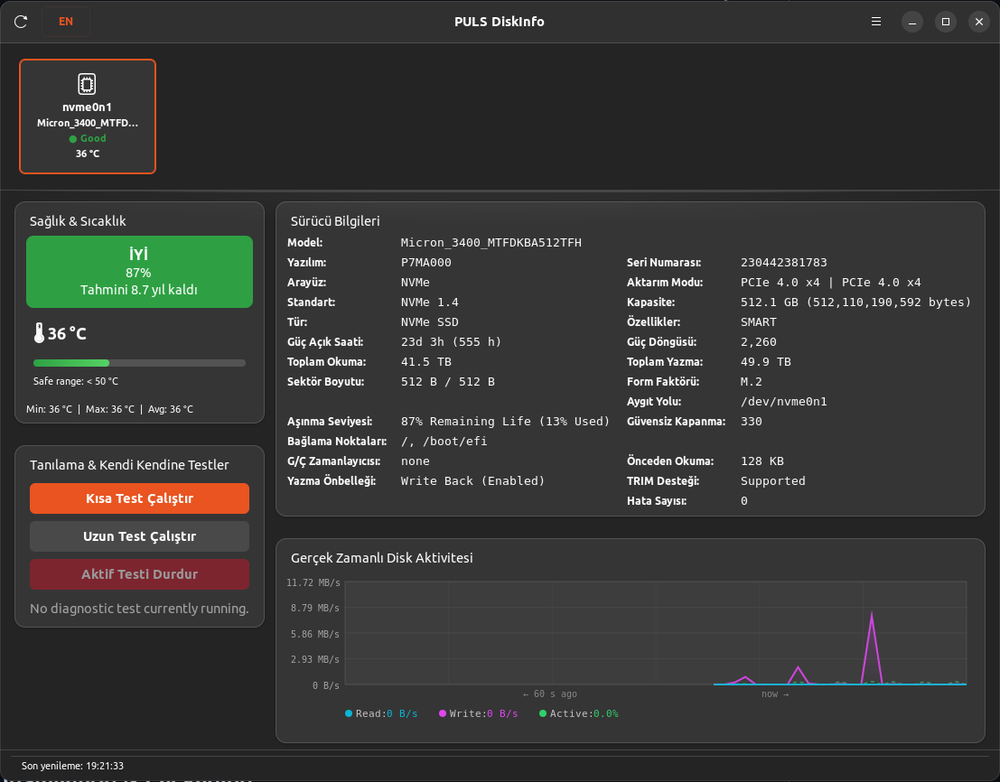
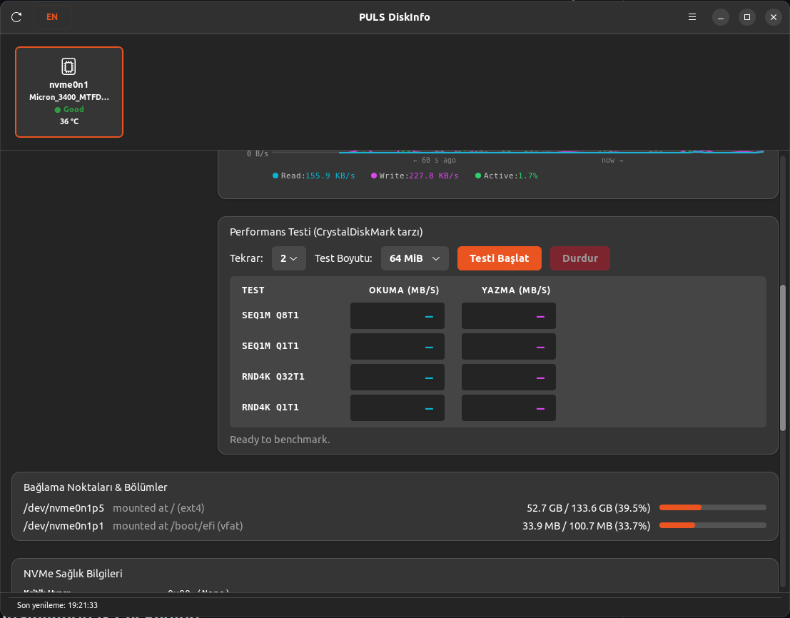
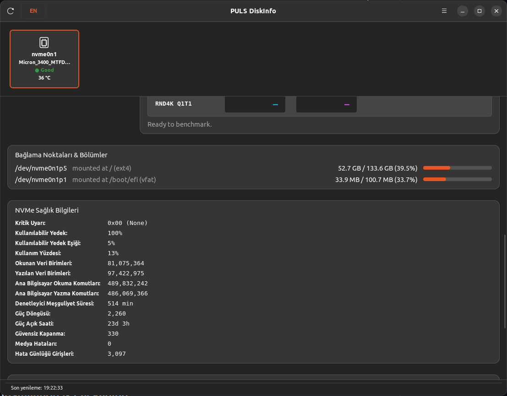
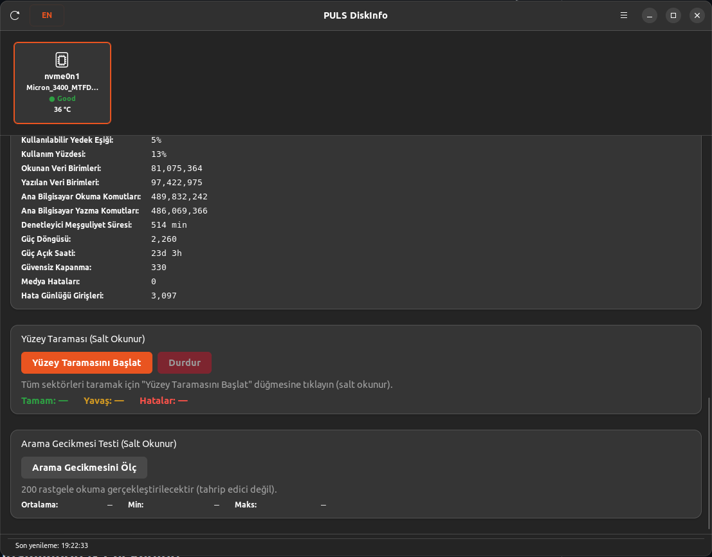

<p align="left">
  
</p>

# PULS DiskInfo

A highly detailed storage health and S.M.A.R.T. monitoring application for Linux, built with **GTK4** and **C**. Inspired by CrystalDiskInfo, it displays critical health status, temperatures, and detailed drive attributes.

<p align="center">
  
  
</p>
<p align="center">
  
  
</p>

---

## Features

- **Multi-Drive Support**: Enumerate and monitor multiple drives (NVMe SSD, SATA SSD, SSHD, HDD, USB, etc.).
- **Health Indicators**: Clear, color-coded health badges (Good, Caution, Bad) based on S.M.A.R.T. attributes.
- **Real-Time Temperature & Unprivileged `hwmon`**: Dynamic thermometer widget with safe ranges and direct Linux kernel `hwmon` readout without root requirements.
- **Hardware Topology & Bus Inspection**: Real-time PCIe link speed & width negotiation (PCIe Gen 1–6, e.g. PCIe 4.0 x4) and USB speed version classification (USB 2.0 to USB4) with bridge controller IC identification (ASMedia, Realtek, JMicron, etc.).
- **Enhanced Partition & Mount Point Mapper**: Complete partition and volume inventory with full support for multi-layer device mapper setups (dm-crypt/LUKS, LVM).
- **Dual Storage Capacity Units**: Display storage capacity in manufacturer Decimal SI (GB/TB), OS Binary IEC (GiB/TiB), or Dual format (`512.1 GB (476.9 GiB)`) with exact byte precision and persistent user toggle.
- **S.M.A.R.T. Attributes Table**: Color-coded, sortable list of all standard attributes with trend tracking.
- **NVMe Specific Logs**: Comprehensive health metrics for NVMe SSDs (available spare, percentage used, media errors, controller busy time, etc.).
- **Headless & CLI Mode**: Run comprehensive disk scans directly in the terminal (`--headless`) or output structured JSON (`--json`) without a display server.
- **Hardware Simulator**: Test and preview storage metrics with built-in mock drives (`--mock-disk`).
- **Polkit Integration**: Clean privilege separation. The main GUI runs unprivileged, calling a small, auditable helper executable via `pkexec` when querying privileged S.M.A.R.T. data.

---

## Command-Line Usage

PULS DiskInfo can be used both as a rich graphical application and as a headless terminal tool:

```bash
# Launch GTK4 graphical interface
puls-diskinfo

# Headless terminal storage health scan
puls-diskinfo --headless

# Machine-readable JSON output for scripts and automation
puls-diskinfo --json

# Test with simulated mock storage devices (NVMe, SATA SSD, HDD, USB)
puls-diskinfo --headless --mock-disk

# Enable structured microsecond-precision diagnostic logging
G_MESSAGES_DEBUG=puls puls-diskinfo --headless --mock-disk

# Display version
puls-diskinfo --version
```

---

## Build Dependencies (Ubuntu 22.04+)

Ensure you have the following packages installed:

```bash
sudo apt update
sudo apt install -y \
  build-essential \
  meson \
  ninja-build \
  pkg-config \
  libgtk-4-dev \
  libadwaita-1-dev \
  libjson-glib-dev \
  smartmontools
```

---

## How to Compile & Run

### 1. Configure Build
Set up the build directory using Meson:
```bash
meson setup build
```

### 2. Compile
Compile the application:
```bash
meson compile -C build
```

### 3. Run Locally
Run the compiled binary directly:
```bash
./build/src/puls-diskinfo
```

### 4. Run Tests & Sanitizers
Run the automated test suite:
```bash
meson test -C build --verbose
```

Build and test with AddressSanitizer (ASan) and UndefinedBehaviorSanitizer (UBSan):
```bash
meson setup build-asan -Db_sanitize=address,undefined
meson test -C build-asan --verbose
```

---

## Installation & Packaging

PULS DiskInfo supports multiple installation and packaging methods:

### Method 1: Pre-built Binaries from GitHub Releases

Download the latest release for your distribution from [GitHub Releases](https://github.com/word-sys/puls-diskinfo/releases):

#### A. Debian / Ubuntu Package (`.deb`)
```bash
sudo dpkg -i puls-diskinfo_1.1.4_amd64.deb
# If dependencies are missing:
sudo apt-get install -f
```

#### B. Standalone Universal AppImage (`.AppImage`)
Runs on almost any modern Linux distribution without installation:
```bash
chmod +x puls-diskinfo-1.1.4-linux-x86_64.AppImage
./puls-diskinfo-1.1.4-linux-x86_64.AppImage
```

#### C. Portable Release Tarball (`.tar.gz`)
Includes binaries, Polkit helper, desktop integration, and automated install scripts:
```bash
tar xzf puls-diskinfo-1.1.4-linux-x86_64.tar.gz
cd puls-diskinfo-1.1.4-linux-x86_64
sudo ./install.sh
```
To uninstall later:
```bash
sudo ./uninstall.sh
```

---

### Method 2: System-wide Build & Install from Source (Meson)

You can compile and install directly to `/usr` or `/usr/local`:

```bash
# Configure for system installation
meson setup build --prefix=/usr

# Compile all components
meson compile -C build

# Install binary, polkit actions, desktop files, and icons
sudo meson install -C build
```

To uninstall:
```bash
sudo ninja -C build uninstall
```

---

### Method 3: Build Packages Locally

Use the built-in packaging scripts to produce distributable packages:

- **Build Debian Package (`.deb`)**:
  ```bash
  ./packaging/build-deb.sh
  ```
  The generated `.deb` package will be saved in `dist/`.

- **Build Portable Tarball & Zip**:
  ```bash
  ./packaging/build-binary.sh
  ```
  Generates `dist/puls-diskinfo-1.1.4-linux-x86_64.tar.gz` and `.zip`.

- **Build Universal AppImage**:
  ```bash
  ./packaging/build-appimage.sh
  ```
  Generates `dist/puls-diskinfo-1.1.4-linux-x86_64.AppImage`.

---

## License

This project is licensed under the GPL-3.0-or-later License - see the `LICENSE` file for details.
