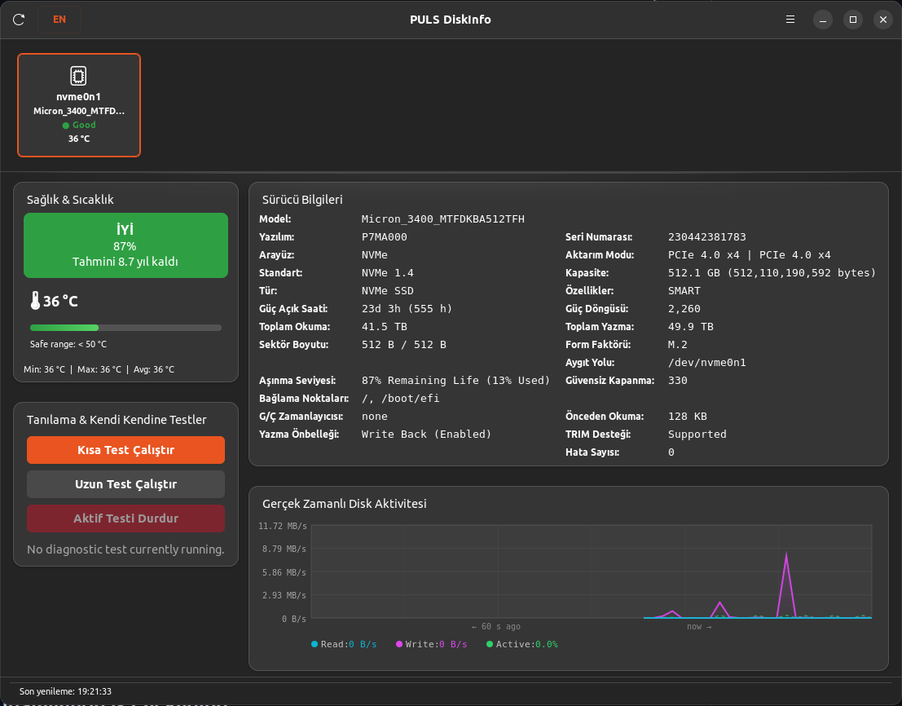
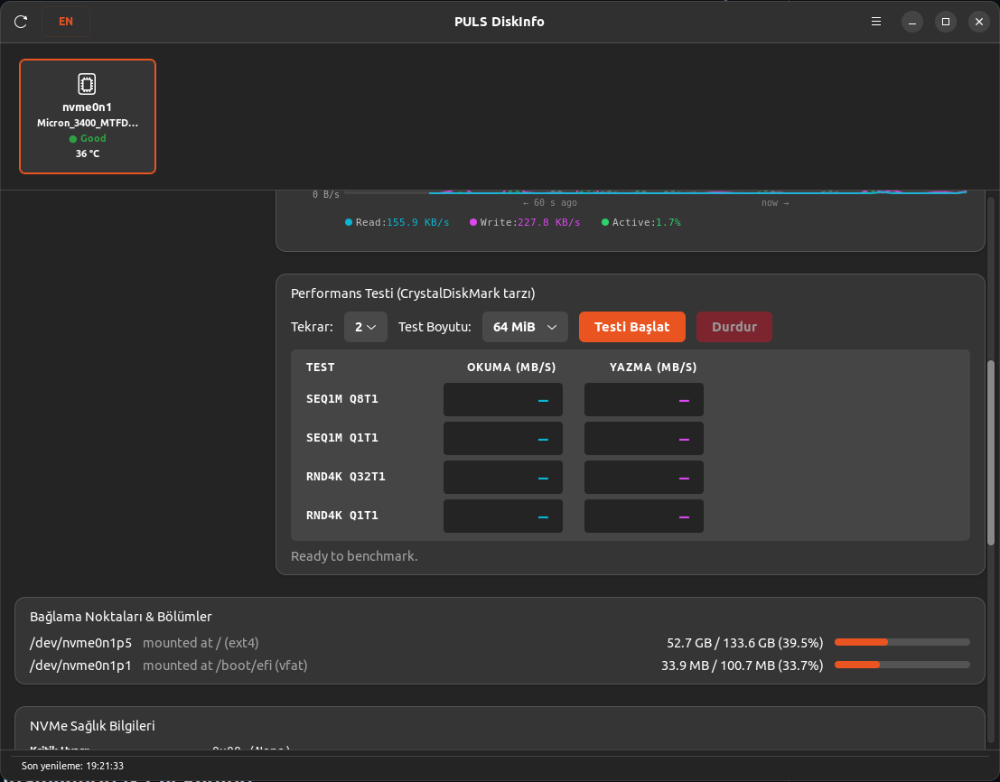
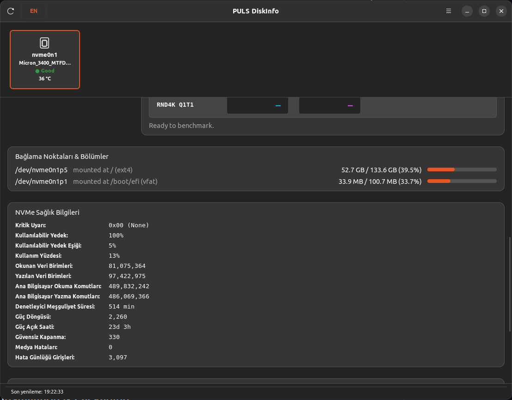
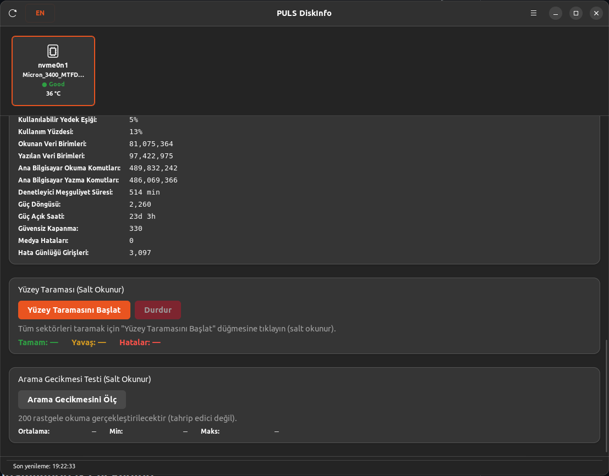

<p align="left">
  
</p>

# PULS DiskInfo

Linux için GTK4 ve C ile geliştirilmiş, kapsamlı bir depolama sağlığı ve S.M.A.R.T. izleme uygulaması. CrystalDiskInfo'dan ilham alınarak tasarlanmış olup kritik sağlık durumunu, sıcaklıkları ve ayrıntılı sürücü niteliklerini görüntüler.

<p align="center">
  
  
</p>
<p align="center">
  
  
</p>

---

## Özellikler

- **Çoklu Sürücü Desteği**: Birden fazla sürücüyü (NVMe SSD, SATA SSD, SSHD, HDD, USB vb.) listeler ve izler.
- **Sağlık Göstergeleri**: S.M.A.R.T. niteliklerine dayalı net, renk kodlu sağlık rozetleri (İyi, Dikkat, Kötü).
- **Gerçek Zamanlı Sıcaklık ve Yetkisiz `hwmon`**: Güvenli aralıklarla dinamik sıcaklık termometre göstergesi ve root yetkisi gerektirmeyen doğrudan çekirdek `hwmon` sıcaklık takibi.
- **Donanım Topolojisi ve Veri Yolu İnceleme**: Gerçek zamanlı PCIe bağlantı hızı ve şerit genişliği (PCIe Gen 1–6, örn. PCIe 4.0 x4) ile USB hız sürümü sınıflandırması (USB 2.0 - USB4) ve köprü yonga seti tanımlama (ASMedia, Realtek, JMicron vb.).
- **Gelişmiş Bölüm ve Bağlama Noktası Haritalayıcı**: Çok katmanlı aygıt eşleyici yapılandırmalarını (dm-crypt/LUKS, LVM) ve bağlı dosya sistemlerini eksiksiz listeler.
- **İkili Depolama Kapasitesi Biçimlendirme**: Üretici standardı Ondalık SI (GB/TB), İşletim Sistemi İkili IEC (GiB/TiB) veya İkili kipte (`512.1 GB (476.9 GiB)`) tam bayt duyarlılığı ve kalıcı kullanıcı ayarı.
- **S.M.A.R.T. Nitelikleri Tablosu**: Tüm standart niteliklerin renk kodlu, sıralanabilir listesi ve eğilim takibi.
- **NVMe'ye Özgü Günlükler**: NVMe SSD'ler için kapsamlı sağlık ölçümleri (kullanılabilir yedek, kullanım yüzdesi, medya hataları vb.).
- **Başsız (Headless) ve Uçbirim Kipi**: Ekran sunucusu olmadan doğrudan uçbirimden disk taraması (`--headless`) veya JSON çıktısı (`--json`) alma desteği.
- **Donanım Simülatörü**: Yerleşik sanal sürücülerle (`--mock-disk`) test ve önizleme yapabilme.
- **Polkit Entegrasyonu**: Temiz ayrıcalık ayrımı. Ana GUI ayrıcalıksız çalışır; S.M.A.R.T. verilerini sorgularken `pkexec` aracılığıyla küçük, denetlenebilir bir yardımcı çalıştırılabilir dosya çağrılır.
- **Türkçe / İngilizce Dil Desteği**: Başlık çubuğundaki dil düğmesiyle anında geçiş yapılabilir; tercih kaydedilir.

---

## Komut Satırı Kullanımı

PULS DiskInfo hem grafiksel arayüzle hem de uçbirim üzerinden başsız kipte kullanılabilir:

```bash
# GTK4 grafik arayüzünü başlat
puls-diskinfo

# Uçbirimde başsız disk sağlığı taraması
puls-diskinfo --headless

# Otomasyon ve betikler için JSON çıktısı
puls-diskinfo --json

# Simüle edilmiş sanal sürücülerle test (NVMe, SATA SSD, HDD, USB)
puls-diskinfo --headless --mock-disk

# Mikrosaniye hassasiyetli yapılandırılmış günlük kaydı
G_MESSAGES_DEBUG=puls puls-diskinfo --headless --mock-disk

# Sürüm bilgisini görüntüle
puls-diskinfo --version
```

---

## Derleme Bağımlılıkları (Ubuntu 22.04+)

Aşağıdaki paketlerin kurulu olduğundan emin olun:

```bash
sudo apt update
sudo apt install -y \
  build-essential \
  meson \
  ninja-build \
  pkg-config \
  libgtk-4-dev \
  libadwaita-1-dev \
  libjson-glib-dev \
  smartmontools
```

---

## Derleme ve Çalıştırma

### 1. Derleme Yapılandırması
Meson kullanarak derleme dizinini oluşturun:
```bash
meson setup build
```

### 2. Derleme
Uygulamayı derleyin:
```bash
meson compile -C build
```

### 3. Yerel Çalıştırma
Derlenmiş ikili dosyayı doğrudan çalıştırın:
```bash
./build/src/puls-diskinfo
```

### 4. Testleri ve Denetleyicileri Çalıştırma
Otomatik birim test paketini çalıştırın:
```bash
meson test -C build --verbose
```

AddressSanitizer (ASan) ve UndefinedBehaviorSanitizer (UBSan) ile derleyip test edin:
```bash
meson setup build-asan -Db_sanitize=address,undefined
meson test -C build-asan --verbose
```

---

## Kurulum ve Paketleme

PULS DiskInfo birden fazla kurulum ve paketleme yöntemini destekler:

### Yöntem 1: GitHub Sürümlerinden Hazır Paketler

Dağıtımınıza uygun en son sürümü [GitHub Sürümleri](https://github.com/word-sys/puls-diskinfo/releases) sayfasından indirin:

#### A. Debian / Ubuntu Paketi (`.deb`)
```bash
sudo dpkg -i puls-diskinfo_1.1.4_amd64.deb
# Bağımlılık eksikliği varsa:
sudo apt-get install -f
```

#### B. Bağımsız Evrensel AppImage (`.AppImage`)
Neredeyse tüm modern Linux dağıtımlarında kurulum gerektirmeden çalışır:
```bash
chmod +x puls-diskinfo-1.1.4-linux-x86_64.AppImage
./puls-diskinfo-1.1.4-linux-x86_64.AppImage
```

#### C. Taşınabilir Sürüm Arşivi (`.tar.gz`)
İkili dosyaları, Polkit yardımcısını, masaüstü entegrasyonunu ve otomatik kurulum betiklerini içerir:
```bash
tar xzf puls-diskinfo-1.1.4-linux-x86_64.tar.gz
cd puls-diskinfo-1.1.4-linux-x86_64
sudo ./install.sh
```
Daha sonra kaldırmak için:
```bash
sudo ./uninstall.sh
```

---

### Yöntem 2: Kaynak Koddan Sistem Geneline Derleme ve Kurulum (Meson)

Uygulamayı doğrudan `/usr` dizinine derleyip kurabilirsiniz:

```bash
# Sistem kurulumu için yapılandır
meson setup build --prefix=/usr

# Tüm bileşenleri derle
meson compile -C build

# İkili dosya, polkit izinleri, masaüstü dosyası ve simgeleri kur
sudo meson install -C build
```

Kaldırmak için:
```bash
sudo ninja -C build uninstall
```

---

### Yöntem 3: Paketleri Yerel Olarak Derleme

Dağıtılabilir paketler üretmek için yerleşik paketleme betiklerini kullanın:

- **Debian Paketi Derleme (`.deb`)**:
  ```bash
  ./packaging/build-deb.sh
  ```
  Oluşturulan `.deb` paketi `dist/` dizinine kaydedilir.

- **Taşınabilir Tarball ve Zip Derleme**:
  ```bash
  ./packaging/build-binary.sh
  ```
  `dist/puls-diskinfo-1.1.4-linux-x86_64.tar.gz` ve `.zip` üretilir.

- **Evrensel AppImage Derleme**:
  ```bash
  ./packaging/build-appimage.sh
  ```
  `dist/puls-diskinfo-1.1.4-linux-x86_64.AppImage` üretilir.

---

## Lisans

Bu proje GPL-3.0-or-later Lisansı kapsamında lisanslanmıştır. Ayrıntılar için `LICENSE` dosyasına bakın.
